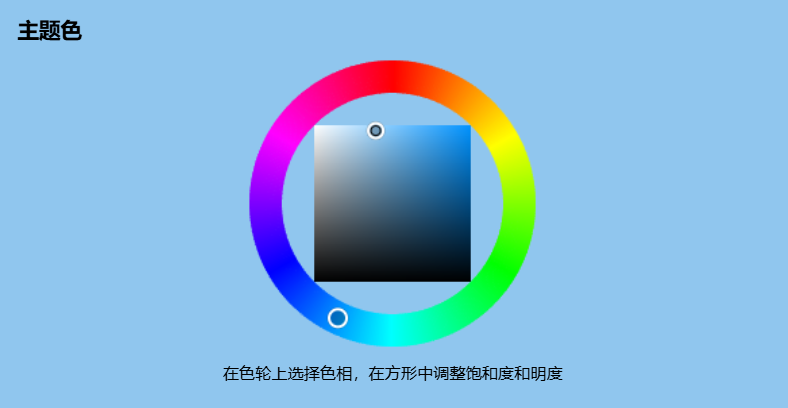
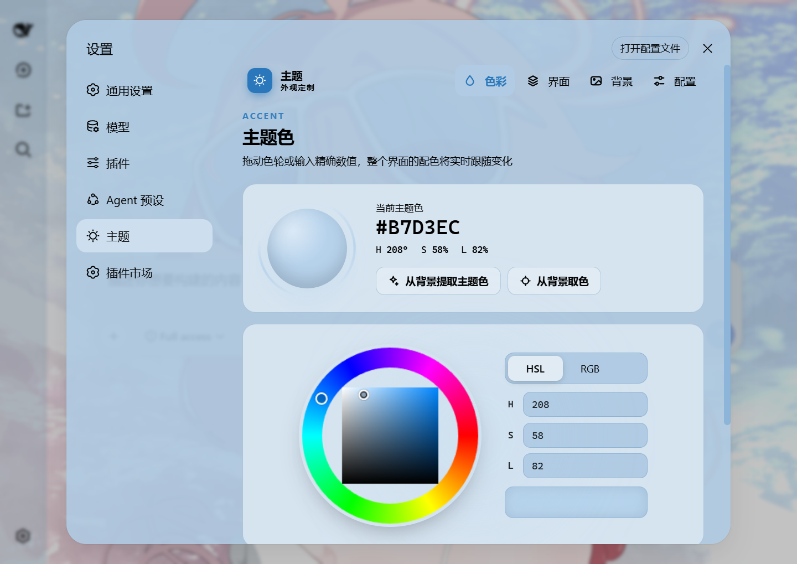
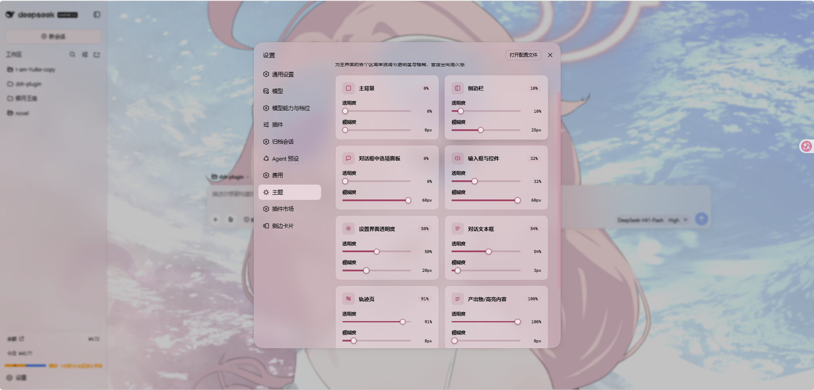
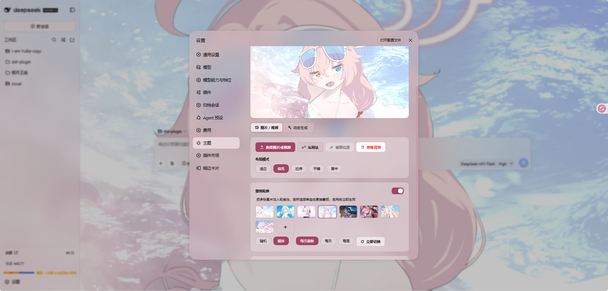
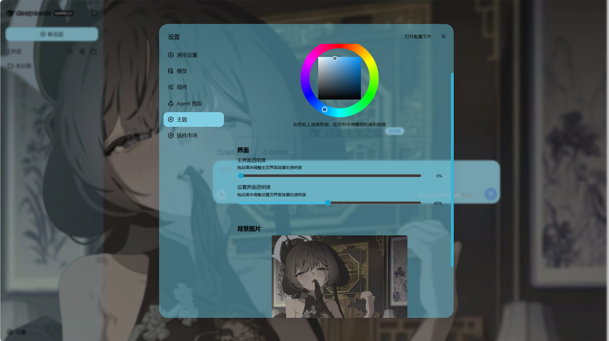
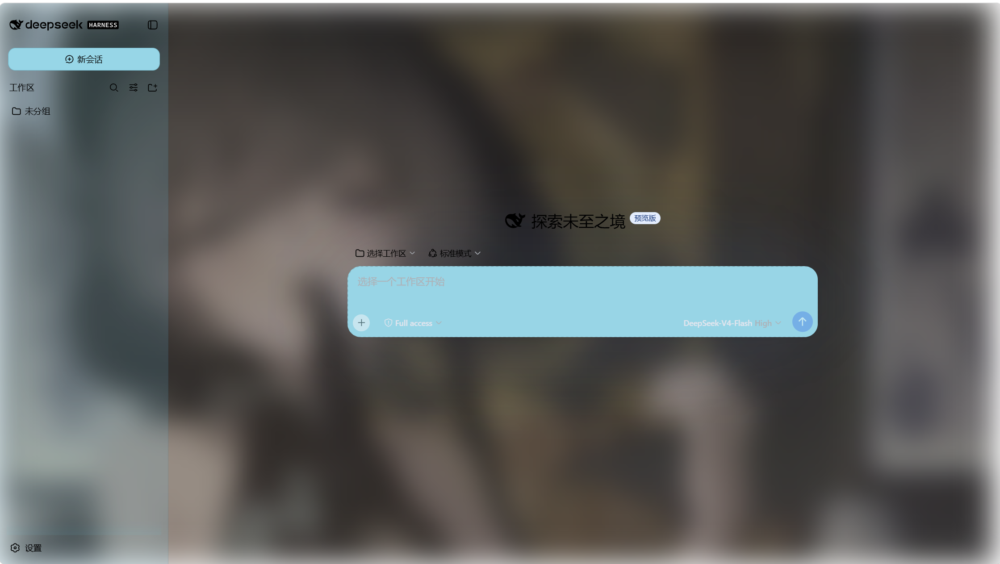
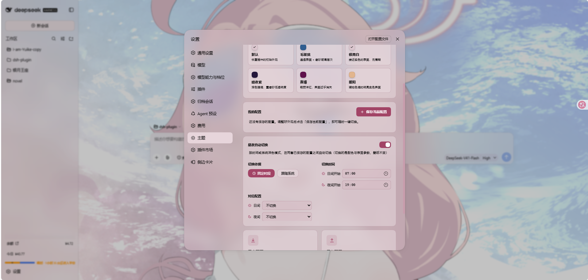

# dsh-any-background

<p align="center">
  <a href="https://www.npmjs.com/package/dsh-any-background"></a>
  <a href="https://www.npmjs.com/package/dsh-any-background"></a>
  <a href="https://github.com/Tkingxiao/dsh-any-background/blob/main/LICENSE"></a>
  <a href="https://www.npmjs.com/package/@deepseek-ai/dsh?activeTab=versions"></a>
  <a href="https://github.com/topics/dsh-better-sidebar"></a><br /><br />
  <a href="https://github.com/Tkingxiao/dsh-any-background"></a>
</p>

English | [中文](README.zh.md)

A **DeepSeek Harness** appearance plugin: custom theme color, background wallpaper (image / video / algorithmically generated), and per-surface opacity & blur control. Compatible with **DSH `0.2.1` through `0.2.3-alpha.2` — and every host release above it**.

---

## Screenshots

<table>
  <tr>
    <td align="center"><br/><em>Custom homepage · wallpaper + theme color applied</em></td>
    <td align="center"><br/><em>Theme color picker · PS-style wheel + HSL/RGB inputs</em></td>
  </tr>
  <tr>
    <td align="center"><br/><em>Per-surface opacity and blur</em></td>
    <td align="center"><br/><em>Background editor · pan and zoom</em></td>
  </tr>
  <tr>
    <td align="center"><br/><em>Generated background · mesh gradient / Shader / geometric</em></td>
    <td align="center"><br/><em>Generated background · geometric low-poly</em></td>
  </tr>
  <tr>
    <td align="center" colspan="2"><br/><em>Export and import configs to share them</em></td>
  </tr>
</table>

## Features

### Color & theme

- **PS-style color wheel** — Hue on the ring, saturation and lightness in the inscribed square; generates 30+ CSS design tokens live.
- **Precise HSL / RGB input** — Numeric entry, bidirectionally synced with the wheel.
- **Smart extraction / eyedropper** — One click derives a theme color from the wallpaper (sampling the visible area and discarding gray, near-black and near-white), or hover any pixel to pick it. Video wallpapers contribute an auto-captured frame. All client-side.
- **Forced light / dark scheme** — Light, dark or auto. In auto the surface and font direction follow the accent color's lightness (dark pick → light text), falling back to the wallpaper's brightness when no accent is set.
- **Theme export / import** — A self-contained `dsh-any-theme.json` (config + wallpaper + the whole rotation pool) that restores anywhere.
- **Presets & profiles** — Six one-click presets plus named profiles that can be renamed and duplicated; deleting asks for confirmation twice.

### Background & wallpaper

- **Image wallpaper** — Upload any image as the background.
- **Video wallpaper** — Muted, looping, survives refreshes (persisted on disk + HTTP Range streaming), with one frame captured for the preview, color extraction and position editing.
- **Position editor & layout modes** — Drag to pan, scroll or pinch to zoom, one-click reset; Fit / Fill / Stretch / Tile / Center. Image and video placements are stored separately and never overwrite each other.
- **Generated backgrounds** — Mesh gradient, Shader or geometric patterns, with adjustable spread and intensity and a lockable seed.
- **Wallpaper rotation** — Build a pool with the thumbnail picker, click a thumbnail to apply it directly, and rotate by shuffle or order on every refresh / hourly / daily / weekly; the cadence advances while the page stays open, not only on reload.
- **URL wallpaper daily refresh** — A wallpaper applied from a URL can re-download itself on the day boundary, for sources that serve a new image over time.
- **Day / night switch** — A day profile and a night profile, switched on a fixed schedule or by following the OS dark mode.

### Per-surface opacity & blur

- **Eleven parts, each with its own slider pair** — main background, sidebar, card panels, input & controls, settings panel, conversation frame, trajectory view, right sidebar (or bettersidebar), produced / highlighted content, header popovers, and the header bar. Slider values are typeable, and hovering a module card outlines the real region it controls.
- **The slider IS the frost amount, and 0 means no frost** — including over the host's own default menu frost. Every part still **defaults to 30px**, so a stock install keeps the frosted look.
- **Opacity re-scopes the host's own token** — it never stacks a second color over the original, so the wallpaper shows through the content.
- **Produced / highlighted content shares one slider** — code blocks (with their language banner), inline `code` chips and produced chips move together.
- **Right sidebar / bettersidebar: one pair, two identities** — without dsh-better-sidebar it drives the official right sidebar; with it installed the same pair takes over that plugin's bottom workbench panel (the official sidebar keeps responding too).
- **On the Windows desktop shell it also drives the caption band** — the sidebar pair paints the segment directly above the sidebar, and the cut follows the sidebar's width as it is dragged or collapsed (at width 0 the band returns to the header card). The 「标题栏」 card drives the rest of the band and the native window controls, with a four-state 「标题条带文字」 choice (auto / follow theme / always white / always black) for when a light strip fights the theme.

### Interface parts

- **Sidebar "Theme" page (dual mode)** — The same five pages (Color / Interface / Font / Background / Profiles) register into the official right sidebar's guide page or into dsh-better-sidebar's sidebar, sharing one state with the settings panel, so a change anywhere shows everywhere. On a host without that extension point nothing is registered, silently.
- **Conversation view cards** — The message list is wrapped in a translucent card automatically, and the trajectory page adjusts as a whole page.
- **Header popovers and the header bar are separately adjustable** — the Agent Team panel, the background-job list, the session-header dropdowns, and the title / view-tab row at the top of a session each have their own opacity + blur pair.
- **Custom font** — Upload a ttf / otf / woff / woff2 (up to 100 MB) and apply it across the interface; code blocks stay monospace. Can be disabled or removed at any time.
- **Per-part text outline** — The same surface groups as the interface page, each with its own `-webkit-text-stroke` (0–4px, 0 = off) in auto-contrast / gray / black / white / accent / custom. Code blocks, inline `code`, icons and the host's gradient-shimmer text are exempt automatically.
- **Third-party compatibility** — When [dsh-better-display](https://github.com/aa2246740/dsh-better-display) is detected, its sticky summary band is pinned at a 20% plate + 30px frost outside the sliders. Other detected plugins get a per-plugin verdict on the settings card (with a copyable report line) instead of a console-only warning, and the whole accommodation can be switched off in Settings.

### General

- **File-based persistence** — Everything is stored under `~/.dsh/.dsh-any-background-data/`, not in `localStorage`.
- **Bilingual UI** — Full Chinese / English interface following the host's locale.
- **Theme watchdog** — Re-asserts the custom theme if the host resets it.

## Installation

### Method 1: npm install (Recommended)

```sh
# published on the npm registry
dsh plugin --profile web add dsh-any-background

# or straight from the GitHub repository
dsh plugin --profile web add github:Tkingxiao/dsh-any-background
```

Then launch:

```sh
dsh web
```

The plugin appears as a **"Theme"** section in Settings.

### Method 2: npx (No Global Install)

```sh
npx @deepseek-ai/dsh plugin --profile web add dsh-any-background
npx @deepseek-ai/dsh web
```

### Method 3: Local Build (Development)

The `lib/` directory is committed, so installs need no build step. To rebuild after editing `src/`:

```sh
git clone https://github.com/Tkingxiao/dsh-any-background.git
cd dsh-any-background
pnpm install
pnpm run bundle
pnpm dsh plugin --profile web add "dsh-any-background"
pnpm dsh web
```

## Compatibility

- **[`dsh web`](https://github.com/deepseek-ai/deepseek-harness): `0.2.1` ~ `0.2.3-alpha.2`, and everything above it.** Hosts below 0.2.1 are no longer supported. The gate names each verified build and then closes with an uncapped `>=0.2.1-alpha.1`: the host enforces exactly this list (its `app-boot` reads `engines.dsh` when present and ignores peerDependencies), so a range that runs out is a wall in front of a plugin that would have kept working.
- **Verified builds** (`dsh.compatibility.dshReleases`):

  | Host build | Facts folder | Notes |
  |---|---|---|
  | `0.2.1-alpha.1` ~ `0.2.1-rc.5` | `v0-2-1` | facts unchanged across the line, folded into one folder; every checked build gets its own row with an `exact` verdict |
  | `0.2.2-alpha.2` | `v0-2-2` | a new patch line, so its own facts folder; every claim re-read and still true |
  | `0.2.2-rc.1` | `v0-2-2` | checked on a real host: gate / RPC / boot self-check all pass; `exact` verdict |
  | `0.2.2-rc.2` / `0.2.2-rc.3` | `v0-2-2` | re-read from both tags' source: same line, same answer; darwin-only sidebar wash tokens joined the 「侧边栏」 slider group |
  | `0.2.2-rc.4` / `0.2.2-rc.5` | `v0-2-2` | source re-read: the whole diff against rc.3 in the packages this plugin speaks for is the `version` field in eight `package.json` files. **rc.5 also booted on a real isolated host**: gate, `read`, upload content key and the rendered page all passed with zero console errors; rc.4 is source-read only |
  | `0.2.3-alpha.1` / `0.2.3-alpha.2` | `v0-2-3` | a new patch line, so its own facts folder; every claim re-read from both tags' source. **No 0.2.3 host is installed here, so loading / RPC were not smoke-tested on a real process for this line** |
  | above `0.2.3-alpha.2` | reuses the closest row | an unverified build takes that line's adapter, stated in the log |

- **Facts are isolated per release**: the host release is resolved on the Node half and handed down through the `read` RPC; styling and logic only ask the adapter questions (who owns this surface, which layer carries the frost, which token fades a menu) and never compare version strings. Supporting a new host means adding one version folder and registering it.
- **A restart is needed after installing or updating the plugin**: the compatibility check runs while the profile is composed, not when the plugin is updated. Features that depend on a specific host structure (the right sidebar's panel blur, the official sidebar's "Theme" card) enable themselves only where that structure exists; everything else behaves identically across the range.
- **[deepseek-harness-desktop](https://github.com/anywhere-labs/deepseek-harness-desktop)** — supported. Windows-only behavior (the caption band, the native window controls) applies on the desktop shell only.

## Permissions, side effects & boundaries

- **Integration form**: an official Profile Bundle — `package.json` declares `dsh.bundle.patch: ./cordis.patch.yml` (a loader insert layer) and the repository ships ready-to-use prebuilt artifacts (`lib/index.js`, `lib/client.js`). No install scripts, no postinstall, no native binaries, no build step at install time.
- **Filesystem**: the server half reads and writes only inside `<dsh home>/.dsh-any-background-data/` (config, wallpaper, rotation pool, video, font) and touches nothing outside it; config writes are atomic (temp file + rename). These files live on the real disk, so they are **outside generation restore — it neither captures nor rolls them back**; deleting the directory is a full plugin reset.
- **Network**: exactly one outbound fetch, and only when the user pastes an http/https image or video URL and presses Apply. No telemetry, no other external calls.
- **Shell / native**: none. No `child_process`, no native modules, no dynamically downloaded binaries.
- **HTTP surface**: only `/dsh-any-background/{video,wallpaper,font}` (GET/HEAD streaming) with the matching `*/upload` POST routes (100 MB cap), plus the dedicated RPC channel `/dsh-any-background`, all under the local dsh web server. No extra listening ports.
- **Restart required**: the first install needs a (re)start of `dsh web` to load the client bundle; settings changes afterwards apply live and persist automatically. Changing plugin version requires a restart to pick up the new `lib/client.js`.
- **Tests & verification**: `pnpm run typecheck` (full tsc check), `pnpm run bundle` (tsdown emits `lib/`), and `npm test`, which starts the real host half and round-trips config writes, reads and profiles plus the upload fence. Visual changes go through two further paths: a local mock page that measures computed values, and real `dsh web` testing slider by slider.
- **Known limitations**:
  - The styling relies on stable host DOM markers (such as `[data-sidebar-right-panel]`) and CSS token names. A host restyle of those layers can leave a slider ineffective for its surface — cosmetic only, nothing breaks. The version-specific half of those selectors lives inside its own version folder, so a host revision normally means editing that one file.
  - `-webkit-text-stroke` may clip about 1px at the edge of some single-line ellipsis containers.
  - One rule is a deliberate cross-plugin accommodation: dsh-better-display paints its sticky reading lanes from the token our 「主界面」 opacity owns, so when that plugin is detected its lanes are pinned at a 20% plate + 30px frost outside the sliders. If it ever renames those markers the rule stops matching and its lanes go back to being painted its own way.

## Changelog

### 0.5.1
- **Per-picture framing** (issue #42): the background editor's committed zoom / pan is now remembered per wallpaper **content** (a host-side SHA-256 key), so switching a rotation pool picture from A to B and back to A restores A's framing instead of resetting it. On upgrade, the old single framing is adopted as the active picture's entry. Importing a theme re-binds rather than inheriting the previous picture's key, so an edit right after an import can't land on the old wallpaper.
- **Saved-config time shows minutes and seconds** (issue #42 ②): the profile list printed the date only, so two saves on one day looked identical.
- **DSH `0.2.3` line supported**: new `v0-2-3` facts folder verified at `0.2.3-alpha.1` / `alpha.2`, plus `0.2.2-rc.4` / `rc.5` rows (`rc.5` also smoke-booted on a real isolated host). The 0.2.3 stylesheet-pipeline change (module-metadata `<style data-plugin data-path>` injection) is documented in that folder; the third-party scanner reads the same attribute.

### 0.5.0
- Dropped the `0.2.0` adapter layer; the supported floor is now DSH `0.2.1`. README trimmed.

## License

MIT
