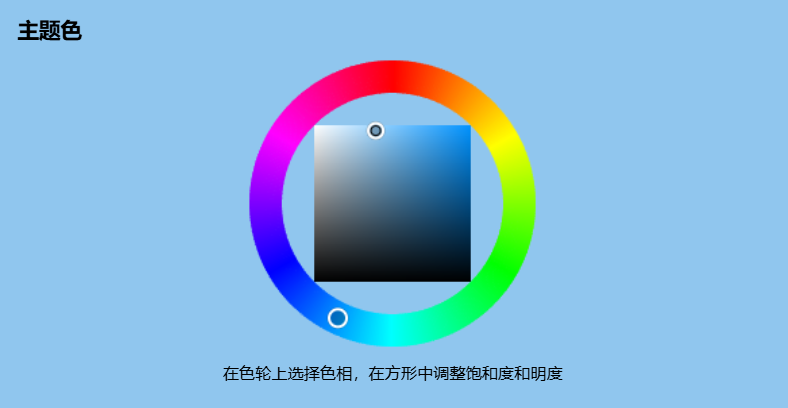
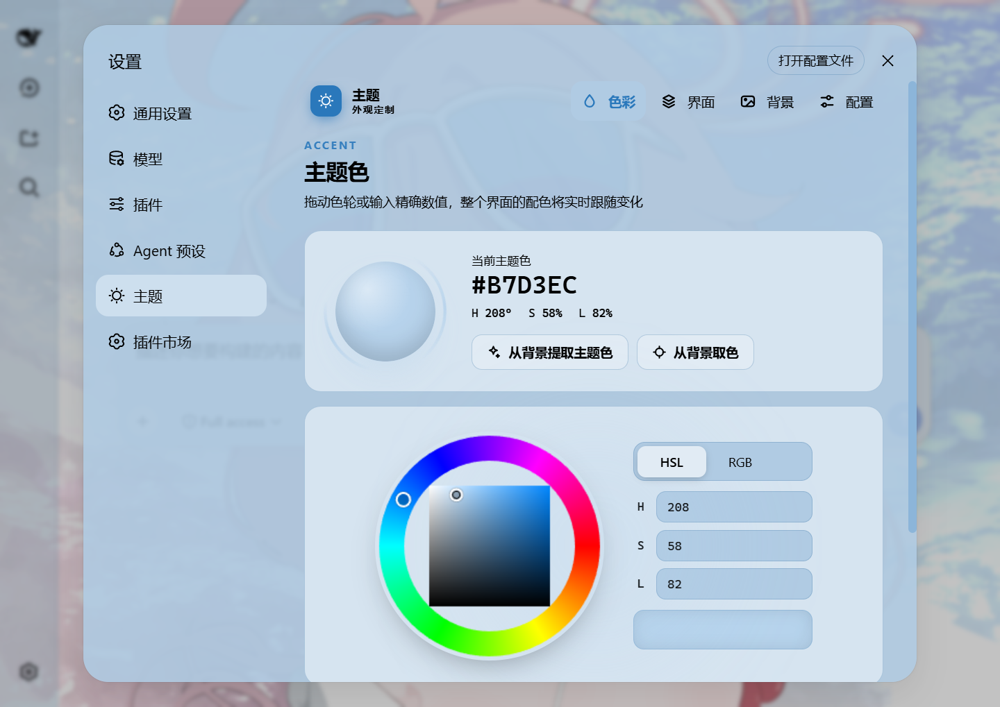
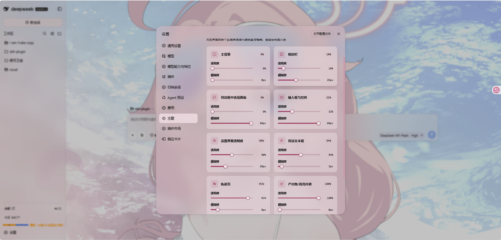
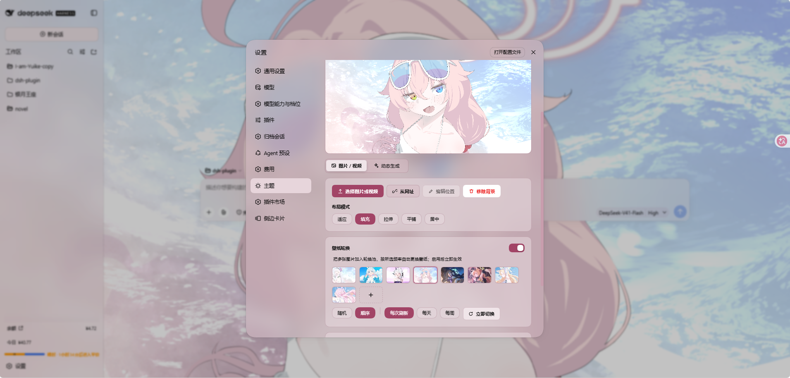
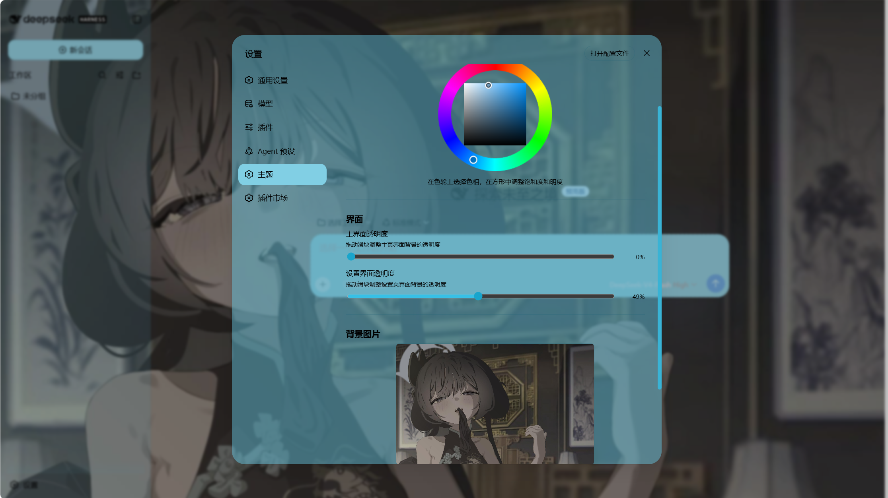
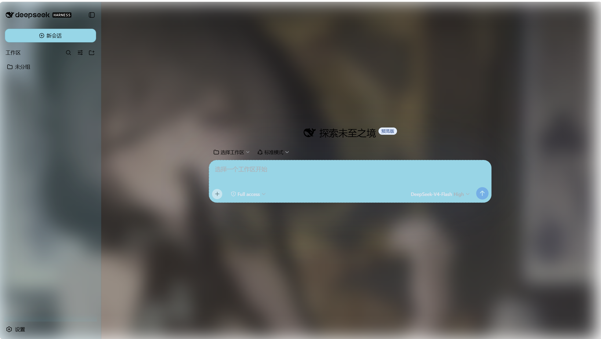
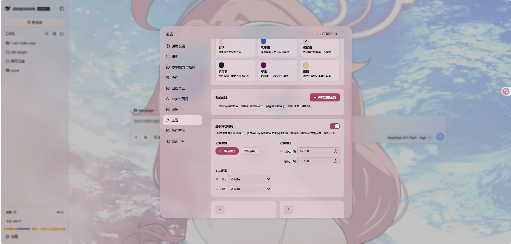

# dsh-any-background

<p align="center">
  <a href="https://www.npmjs.com/package/dsh-any-background"></a>
  <a href="https://www.npmjs.com/package/dsh-any-background"></a>
  <a href="https://github.com/Tkingxiao/dsh-any-background/blob/main/LICENSE"></a>
  <a href="https://www.npmjs.com/package/@deepseek-ai/dsh?activeTab=versions"></a>
  <a href="https://github.com/topics/dsh-better-sidebar"></a><br /><br />
  <a href="https://github.com/Tkingxiao/dsh-any-background"></a>
  <a href="https://dsh.directory/plugins/tkingxiao/dsh-any-background"></a>
</p>

English | [中文](README.zh.md)

A **DeepSeek Harness** appearance plugin: custom theme color, background wallpaper (image / video / algorithmically generated), and fine-grained per-surface opacity & blur controls. Compatible with **DSH `0.2.0-rc.1` through `0.2.1-rc.3` — and every host release above it** (official-Sidebar UI such as the "Theme" card enables itself where the host exposes the Sidebar registry extension point, and is skipped silently where it does not).

---

## Screenshots

<p align="center">
  
  <br/>
  <em>Custom homepage · wallpaper + theme color applied</em>
</p>

<p align="center">
  
  <br/>
  <em>Theme color picker · PS-style wheel + precise HSL/RGB inputs</em>
</p>

<p align="center">
  
  <br/>
  <em>Per-part opacity and blur · main background, sidebar, cards, settings</em>
</p>

<p align="center">
  
  <br/>
  <em>Background editor · image/video wallpapers support drag-to-pan and scroll-to-zoom</em>
</p>

<p align="center">
  
  <br/>
  <em>Generated dynamic background · mesh gradient / Shader / geometric presets</em>
</p>

<p align="center">
  
  <br/>
  <em>Generated dynamic background · geometric low-poly mode preview</em>
</p>

<p align="center">
  
  <br/>
  <em>Export and import configs to share</em>
</p>

## Features

- **PS-style Color Wheel** — Pick hue on the ring, adjust saturation & lightness in the inscribed square. Generates 30+ CSS design tokens in real time.
- **Precise HSL / RGB Input** — Enter exact color values numerically with instant bidirectional sync to the wheel.
- **Smart Color Extraction** — One click derives a theme color from your wallpaper by sampling the visible region, quantizing, and filtering out gray / near-black / near-white pixels. Video wallpapers contribute via an auto-captured frame. Fully client-side.
- **Eyedropper** — Hover the wallpaper to preview a color and click to pick it as the theme color.
- **Background Wallpaper** — Upload any image as your wallpaper. Drag to pan and scroll to zoom inside a viewport-proportional editor (one finger to pan, two to pinch-zoom on touchscreens).
- **Video Wallpaper** — Use a video as a live wallpaper: muted looping playback that survives refreshes (file persistence + HTTP streaming with Range seek), with an auto-captured frame powering the preview, theme-color extraction, and the position editor.
- **Position Editor** — One shared editor for images and videos: drag to pan, scroll or pinch to zoom, one-click reset. Image and video placements are stored separately and never overwrite each other.
- **Layout Modes** — Fit / Fill / Stretch / Tile / Center for both images and videos; in Fit mode the editor-committed framing stays consistent across window resizes and cross-monitor moves.
- **Generated Dynamic Backgrounds** — Choose mesh gradient, Shader, or geometric patterns with adjustable spread, intensity, and seed locking.
- **Per-surface Interface Opacity** — Independent sliders for the main background, sidebar, cards & panels (including the dropdowns and menus around the dialog), the input & controls (composer box, Cordis panel), the settings panel, the conversation text frame, the trajectory view, the right sidebar (or bettersidebar), produced / highlighted content, the header popovers (Agent Team panel, background-job list and the session-header dropdowns), and the header bar (the conversation's title / view-tab row).
- **Per-surface Interface Blur** — Frosted-glass `backdrop-filter` blur (0–60 px) per surface, including a real backdrop on the composer, the Cordis panel and popover surfaces via stable host selectors. The slider IS the frost amount, and **0 means no frost** — including over the host's own default (`--dsw-menu-backdrop-filter: blur(40px) saturate(150%)`). Through 0.3.7 a 0 meant "leave the host alone", which made the bottom of the slider the blurriest setting it could produce (0 = the host's 40 px, 1 = 1 px) and left "turn the blur off" unreachable; now 0 is 0, and because every part still DEFAULTS to 30 px a stock install keeps the frosted look unless someone drags it down.
- **Left sidebar + the caption band above it** — On the Windows desktop shell the sidebar's opacity + blur pair drives the sidebar column AND the segment of the window caption strip that sits directly above it. The host paints that strip as one full-width box; the plugin cuts it at the sidebar's own published width (`--dsh-windows-sidebar-width`), so the left part carries the sidebar's material and frost and the rest stays the 「标题栏」 card's. Drag the sidebar wider, or collapse it to `0px`, and the cut moves with it. The split is deliberate (issue #29, item 3): the left strip IS the sidebar column's own surface, so the header-bar sliders are not meant to reach it.
- **Produced / Highlights** — Code blocks in conversation content (with their language banner), inline `code` highlight chips and produced chips share one opacity + blur slider. The opacity is the alpha of **each surface's own background color** (no second color stacked on top of the original), and the blur frosts that same layer so the wallpaper shows through the content.
- **Right sidebar / bettersidebar surface** — One slider pair (`panelOpacity` / `blurs.panel`), two identities: without dsh-better-sidebar it reads "右方侧边栏" (Right sidebar) and drives the official right Sidebar's surface tokens and frosted blur (works on 0.1.5-rc.2 through 0.1.7); with dsh-better-sidebar installed it reads "bettersidebar" and takes over that plugin's bottom workbench panel (the official sidebar keeps responding too). The row is always visible.
- **Header popovers** — The session-header dropdowns get their own opacity + blur pair: the Agent Team panel, the background-job list, the open-in-app / session-log menus and the subagent lineage tree. On 0.1.7 the open-in-app picker moved to a portal and the session-row menu became a dynamic slot, so the plugin observes the stable `conversation.session.header*` slot anchors and tags the open popover at runtime instead of relying on class shapes. A popover counts as the header's when it is portaled to `<body>` **or** mounted inside one of those anchors — the session-log `…` menu is the second kind (`session-log-export/HeaderAction.tsx` renders its `Menu` without `portal`), and until 0.3.9 only a fragile `_denseList`-class arm reached it.
- **Header bar (the session title row)** — The row carrying the session title, its actions and the view tabs gets a slider pair of its own. The host paints nothing there (the centre column's background shows straight through), so once a wallpaper is up the title and tabs sat on the raw picture while every masked surface around them did not. It now paints as a region tint, the same recipe as the chat column's card: the material is the plugin's main-background surface at this part's own opacity, so the bar reads as one band over the column rather than a second colour stacked on it. The frost rides a `::before` underlay behind an `isolation:isolate` on the row — a stacking context that is NOT a backdrop root, which is what lets the overlays hanging off the row frost the wallpaper at all (through 0.3.8 the filter sat on the row itself, and a filtered row is a backdrop root: exactly those panels were left blurring a flat tint). Because that context still localizes the row's paint order, the row carries a compensating `z-index:10` — the overlays it hosts (the background-job list through `0.2.1-alpha.1`, the schedule task menu and the session-log `…` menu on every release) hang out of it with `z-index:100` and would otherwise be confined under the conversation. 10 clears the in-column chrome it overlaps (seat 9, back-to-bottom 8) and stays under every page-level surface (100 / 1000 / 1100), so nothing about the part's look changes when a menu opens. `z-index` needs no `position` — the row is a flex item, where it applies on its own — and the underlay's `position:relative` is written inline only while a blur exists and only when the host left the row `static`. See v0.3.7 / v0.3.9. On the Windows desktop shell the band it drives is split with the sidebar (previous bullet), dims itself while a modal is open (the host mask deliberately stops below the caption), and its generated segment is paint-only — `pointer-events:none` and no `app-region` declaration — so it can never swallow clicks meant for the native caption menubar (issue #29). It also paints below the
controls (`z-index:-1`) and carries its own ink (`--dsh-any-caption-ink`), so the sidebar toggle and the
应用 / 编辑 menubar stay readable even when a low sidebar opacity makes the strip light — and 「标题条带文字」 says who wins when the strip's brightness and the theme's direction disagree (自动 derives it from the strip, 跟随主题 leaves the host's own label ink alone, 始终白色 / 始终黑色 pins it; see issue #30). The anchor is expressed in CSS (the row is the `conversation.session.header` slot's direct parent) instead of guessing a hashed class or tagging a host element at runtime; before `0.1.7-alpha.1` the host mounts that slot bare with no such element, so there the rule matches nothing and the part is simply inert. On the Windows desktop shell the same slider pair also drives the window caption band — except for the segment that sits above the left sidebar, which belongs to that sidebar's own pair (see **Left sidebar + the caption band above it**) — and the native minimize/maximize/close block is handed `transparent` so Windows paints no background of its own, leaving the band itself showing through. A blank session marks the row `headerBlank` (a placeholder left with only its padding) and the plugin skips claiming it.
- **Sidebar "Theme" page (dual mode)** — The same five pages (Color / Interface / Font / Background / Profiles) register into two surfaces: without dsh-better-sidebar, a "Theme" card is contributed to the **official right Sidebar's guide page** through its public extension points (`sidebarRightTabs` + the `sidebar.right.pane.tab` keyed seat); with dsh-better-sidebar installed, the page registers in that plugin's sidebar instead and the official guide card withdraws itself, so the two never duplicate. Settings panel, official sidebar and better-sidebar all share one page implementation and one state store — a change in any of them shows up everywhere. The shell adapts to the panel width, and a narrow panel tightens padding and falls back to a single column. On a host without the right Sidebar the registration silently never happens.
- **Conversation View Cards** — The message list is wrapped in a translucent card automatically, and the trajectory page gets whole-page opacity & blur controls, letting the wallpaper shine through the content.
- **Theme Export / Import** — One-click export to a self-contained `dsh-any-theme.json` (config + wallpaper, video embedded as a data URL) and import to restore it anywhere.
- **Appearance Presets & Profiles** — Six one-click presets (Default / Frosted glass / Minimal / Midnight / Cyber / Warm daylight) plus named profiles: save the current look and re-apply it anytime. A two-step confirm guards deletion.
- **Wallpaper Rotation** — Add images to a rotation pool (thumbnail picker included) and let the wallpaper change by shuffle or order on every refresh, daily, or weekly. Advancing copies the chosen image into the active wallpaper slot, so export/import and color extraction keep working unchanged.
- **Day/Night Auto Switch** — Assign a day profile and a night profile; the plugin switches automatically at fixed clock times or by following the OS dark mode.
- **Custom Font** — Upload a ttf / otf / woff / woff2 file (up to 100 MB) and apply it to the whole interface through `@font-face`; toggle it off or remove it at any time. Fonts stream as raw bytes and persist in the plugin data dir; code blocks keep their monospace stack.
- **Per-part Text Outline** — The same surface groups as the interface page (now eleven, including the header popovers and the header bar), each with its own `-webkit-text-stroke`: width 0–4 px (0 = off) and a color of auto-contrast / gray / black / white / accent / custom. Code blocks, inline `code`, icons and the host's `background-clip: text` shimmer chrome (the "深度求索中" turn-status line and the turn-process rows) are exempted automatically, so multi-color syntax never smears and gradient text is never flattened into a stroke-coloured blob.
- **Forced Interface Scheme** — Force light or dark token palettes regardless of the accent color's lightness; in `Auto` both the surface and font directions follow the accent's lightness (dark pick → light fonts, light pick → dark fonts), falling back to the wallpaper's perceived brightness when no color is picked.
- **File-based Persistence** — All settings are stored on the filesystem under `~/.dsh/.dsh-any-background-data/`, not `localStorage`.
- **Bilingual** — Full Chinese / English UI with automatic locale detection.
- **Theme Watchdog** — Re-asserts the custom theme if the host resets it.

## Changelog (latest two releases)

### v0.3.10 (0.2.1-rc.3 verified: one more SUPPORTED_RELEASES row, no new facts)

- **`0.2.1-rc.3` is a checked build now, not a clamped guess.** `git diff rc.2 rc.3` over every file the `0.2.1` adapter speaks for comes back empty where it matters: `design-platform.css`, both menu stylesheets and `MenuGroup.tsx` are byte-identical, and so are `SidebarRight.module.css`, `TabLayout.tsx`, `base.css`, `gradient-shadow-text.css`, `AppFrame.*`, `InlineEditor.module.css`, `TextShimmer`, `JobListAction`, `TaskMenu`, `scoped-slots` and `PluginManagerPage.tsx`, and the five header slot keys stand. The adapter's facts hold, so rc.3 joins `v0-2-1` with a `SUPPORTED_RELEASES` row — its verdict reads `exact` — and the folder's header records what the tag did move: `Menu.tsx` is additive (an `aria-current` render and a portal-only `min-width` switch, with no stylesheet moving alongside), the guide and the sidebar panel list grow pin state and More menus AROUND the existing registrations while the tab registry in `shell/` is untouched, the session header's new View-row More menu mounts through `<Menu … portal>` to `document.body` and is therefore already claimed by the tagger's portaled arm, and `ConversationRoot.module.css` only re-lays the View tab row. `engines.dsh`, the six gated `@deepseek-ai/dsh-*` peers, `dsh.compatibility.dsh` and `dsh.compatibility.dshReleases` all name `0.2.1-rc.3`.

### v0.3.9 (Issue #30 makes the caption ink a choice, and the header sliders reach every header popover)

- **The caption strip's ink is the user's call now (issue #30).** 0.3.8 derived it from what the strip is actually painted on, which fixed the invisible white toggle — and made the native menubar (「应用 / 编辑」) black under a dark theme whose sidebar is translucent over a bright wallpaper, because there the strip really IS light. The two reports of that one situation wanted opposite winners, so the 「标题栏」 card gained a 「标题条带文字」 selector: **自动** keeps the strip-following derivation, **跟随主题** emits no override at all (the menubar and the sidebar's fixed caption controls read the host's own label tokens, exactly as they did through 0.3.7), **始终白色 / 始终黑色** pin it. The key is stored and whitelisted on the host half too — the #28 lesson is that a key only one half knows is silently dropped at write time — and `npm test` round-trips it, including an unknown value collapsing to `auto`.
- **In-place header popovers are claimed, and the claim no longer waits for a frame.** `header-tag.ts` accepted a popover only when its parent was `<body>`, so the session-log `…` menu — which `session-log-export/HeaderAction.tsx` renders WITHOUT the `portal` prop, inside `[data-slot="conversation.session.header.utilities"]` — was never tagged, and the only thing styling it at all was the header group's `[role="menu"][class*="_denseList"]:not([class*="_portal"])` arm. That arm dies the moment the host drops `dense` (or ships a header popover that is not a dense menu), and until then the panel followed the 「卡片」 slider while sitting in the title row. A candidate is now "portaled to `<body>`, **or** a descendant of one of the header's own slot anchors": a modal is still never claimed, and the composer's in-place lists stay with the card group that owns them. The observer's flush also moved off `requestAnimationFrame` onto the microtask queue, which is the other half of "still doesn't work": a queued frame does not run while a window is not painting (hidden tab, occluded or minimized desktop window, background Electron surface), so the tag simply never landed and the panel kept whatever the card group gave it — measured live in `dsh web`, an open header menu stayed untagged indefinitely on a non-painting page, and the same menu was tagged on the next microtask after this change. A microtask coalesces a mutation burst exactly as an animation frame did (the observer callback is already per-batch) with no dependency on the compositor, and it lands in the frame the popover mounts, so the panel no longer flashes the card look on open either.
- **The 「标题栏」 row's frost stopped eating its own children's blur.** `backdrop-filter` on the row made the row a BACKDROP ROOT as well as a stacking context, so an in-place header popover could only ever blur what the row itself paints — a flat tint — and the header blur slider read dead on exactly the panel that hangs off the row. The frost now rides a `::before` underlay behind an `isolation:isolate` (a stacking context that is NOT a backdrop root), which is the recipe this plugin already uses for the frame, the composer capsule and every part column; the row keeps its compensating `z-index:10`, and the underlay's `position:relative` is written inline only while a blur exists and only when the host left the row static.  Measured in the real `dsh web` app (the plugin linked from this working tree, driven through the actual 「顶栏选项」 sliders on the 界面 page): the in-place `…` menu and the portaled open-in-app menu both report `rgba(243,247,252,1)` at opacity 100 / blur 4 and `rgba(243,247,252,0.08)` at opacity 8 / blur 44. Measured again in a browser harness running the plugin's real client code over the host's own built CSS: the row reports `backdrop-filter: none`, its `::before` reports the slider's blur, and every header popup shape — portaled dense `MenuSurface`, in-place dense, in-place non-dense, the role-less job-list surface, the lineage tree — takes the 顶栏 pair's fill and frost instead of the card's.
- **The interface-opacity sliders work on a fresh install now.** `readHostOpacityTokens()` sampled `getComputedStyle(:root)`, but `design-platform.css` declares this whole token set inside a `body { … }` block and a custom property is inherited downward only — so with no picked theme color every read came back empty, `applyCustomTokensNow` took its `surfaces === null` exit, and the 侧栏 / 卡片 / 输入框 / 顶栏选项 alphas were never emitted at all. The sample now comes off `body`, cached per host generation (its dark-mode marker plus the platform attribute), and the plugin's own `body{}` token sheet is switched off while reading — otherwise the second sample returns the plugin's own substituted literal and the surfaces freeze at whatever color they first had instead of following the host.
- **A 0 on a menu blur slider now means no frost.** 0.3.7 introduced a `<html>` class gate (`dab-card-frost` / `dab-header-frost`) so a slider parked at 0 would not delete the host's own `--dsw-menu-backdrop-filter: blur(40px) saturate(150%)` — an element's own declaration always beats what it inherits, so the un-gated `var(--x, none)` really did clear it. The gate turned out to be the wrong trade: it made the slider's LOW end its HIGH end (0 → the host's 40 px, 1 → 1 px), so 「把模糊度关掉」 was unreachable and the control read as dead at exactly the position the user was testing. The frost token is now asserted at every value with the `none` fallback winning at 0, and the gate machinery is gone. Nothing loses the host look by accident: every part default is 30 px, so a stock install is frosted and only an explicit drag to 0 clears it.
- **No release-table change.** The shapes above were re-checked against the installed `0.2.0-rc.1`, `0.2.1-alpha.3` and `0.2.1-rc.2` bundles: both utilities controls, `MenuSurface`'s `data-menu-material` + `.material` painter and the menu token set are identical across the three, so the `0.2.1` adapter's facts still hold.

## Installation

### Method 1: npm install (Recommended)

```sh
# published on the npm registry
dsh plugin --profile web add dsh-any-background

# or straight from the GitHub repository
dsh plugin --profile web add github:Tkingxiao/dsh-any-background
```

Then launch:

```sh
dsh web
```

The plugin appears as a **"Theme"** section in Settings.

### Method 2: npx (No Global Install)

```sh
npx @deepseek-ai/dsh plugin --profile web add dsh-any-background
npx @deepseek-ai/dsh web
```

### Method 3: Local Build (Development)

The `lib/` directory is committed, so installs need no build step. To rebuild after editing `src/`:

```sh
git clone https://github.com/Tkingxiao/dsh-any-background.git
cd dsh-any-background
pnpm install
pnpm run bundle
pnpm dsh plugin --profile web add "dsh-any-background"
pnpm dsh web
```

## Compatibility

- **[`dsh web`](https://github.com/deepseek-ai/deepseek-harness) `0.2.0-rc.1` ~ `0.2.1-rc.3`, and everything above it with it** — `engines.dsh`, the gated `@deepseek-ai/dsh-*` `peerDependencies` and `dsh.compatibility.dsh` name the builds this plugin was checked against one by one (`0.2.0-rc.1`, `0.2.0-rc.2`, `0.2.1-alpha.1` … `0.2.1-rc.3`) and close with an uncapped `>=0.2.0-rc.1`, so every later release loads. The uncapped umbrella is the deliberate choice: the host enforces exactly this peer list — a release it does not name is disabled before a single module is imported — so a range that runs out is a wall in front of a plugin that would have gone on working. An unseen release gets the closest verified adapter plus a log line saying how far from `exact` that is, and the worst a stale guess can cost is one slider no longer fading a surface the host has since moved; a version check that failed closed would have cost the whole plugin. `dsh.compatibility.dshReleases` records which builds were checked and how: every release in the list was checked by diffing its tag against the adapter folder that answers for it. That enforcement still means a `dsh web` restart when the plugin is installed or updated — the check runs while the profile is composed, not when the plugin is updated — but the uncapped umbrella is what spares a machine that has already moved to a newer host from needing a plugin release or a manual exact-version exemption (`dsh plugin allow-version`) first. The host release is resolved on the Node half at runtime, and features that depend on a specific host release channel (the right Sidebar's panel blur, the official Sidebar's "Theme" card) enable themselves only where the corresponding host structure exists; everything else behaves identically across the range. THE `0.1.5` / `0.1.6` / `0.1.7` ERA IS OUT OF THE SUPPORTED RANGE: those adapter folders asserted facts nothing re-checks any more, and the range above now starts at `0.2.0-rc.1`, so an older host is refused at composition rather than quietly styled with the wrong adapter.
- **Isolated per-version adaptation**: the release is resolved on the Node half from the app manifest the process was composed from (`ctx.profileContext.installAnchor`, with the launcher's on-disk layout behind it — the client context exposes no version) and, once handed down through the `read` RPC, is routed only by the front-layer adapter — `src/host-compat/` detects and buckets channels, while `src/client/host-compat/versions/` holds **one folder per set of verified facts** (`v0-2-0-rc-1` / `v0-2-0-rc-2` / `v0-2-1` / `unknown`), each describing that version's panel mechanics, header slot keys, plugin-page shape and where a menu's paint lives. A folder is keyed to what its facts cover, not to the shape of the version number: `0.2.0-rc.1` and `0.2.0-rc.2` are one prerelease channel, but rc.2 renamed the token a sticky menu group heading paints from, so the line carries two folders and the newer one is named for the build that opened it. A newer build whose facts did NOT move joins the folder that held instead of opening one of its own — the whole `0.2.1` line (`alpha.1` … `rc.3`) sits in `v0-2-1` for exactly that reason, with one `SUPPORTED_RELEASES` row per checked build so each verdict reads `exact` rather than `line`. Base code just asks the adapter questions (who owns the guide surface, which layer carries the blur, which token fades a menu) and never compares version strings. Another build on a verified patch line (a future `0.2.1-rc.4` against a table checked through `rc.3`) keeps that line's adapter, and a patch line nothing was checked against clamps to the nearest one with a log line saying so — which is the arm that now serves every release above `0.2.1-rc.3`. Only a release that will not parse at all falls into `unknown` and probes the DOM shape instead of guessing (`:has()` dual arms); supporting a new host means adding one folder and registering it.
- **[DSHA](https://github.com/DSH-APP/DSHA)** — DeepSeek Harness Android launcher (ROOT-free, Termux-free). Its bundled `dsh` is `0.1.5-rc.2`, BELOW this plugin's supported floor since v0.3.7: the peer gate refuses it at composition, so the plugin never loads there rather than restyling that shell with 0.2.x facts.
- **[deepseek-harness-desktop](https://github.com/anywhere-labs/deepseek-harness-desktop)** — Supported

## Permissions, side effects & boundaries

- **Integration form**: official Profile Bundle — `package.json` declares `dsh.bundle.patch: ./cordis.patch.yml` (a loader insert layer), the repository ships prebuilt runtime artifacts ready to use (`lib/index.js`, `lib/client.js`), and there are no install scripts, no `postinstall`, no native binaries, and no build step at install time.
- **Filesystem**: the server half reads and writes only inside `<dsh home>/.dsh-any-background-data/` (config JSON, wallpaper, rotation pool, video, font) and touches nothing outside it; config writes are atomic (temp file + rename). These files live on the real disk, so they are **outside generation restore — it neither captures nor rolls them back**; deleting the directory is a full plugin reset.
- **Network**: one outbound fetch happens only when the user pastes an http/https image or video URL and presses Apply; no telemetry, no other external calls.
- **Shell / native**: none. No `child_process`, no native modules, no dynamically downloaded executables.
- **HTTP surface**: registers only `/dsh-any-background/{video,wallpaper,font}` (GET/HEAD streaming) with matching `*/upload` POST routes (100 MB cap) and the dedicated RPC channel `/dsh-any-background` under the local dsh web server; no extra listening ports.
- **Restart requirements**: the first install needs a (re)start of `dsh web` to load the client bundle; settings changes afterwards apply live and persist automatically. Updating the plugin requires a restart to pick up the new `lib/client.js`.
- **Tests & verification**: `pnpm run typecheck` (full tsc check) and `pnpm run bundle` (tsdown emits `lib/`); no automated unit tests — behavior is verified manually.
- **Known limitations**: the styling relies on stable host DOM markers (`[data-sidebar-right-panel]`, `[data-dsh-bottom-panel]`, …) and CSS token names; a host restyle of those layers can leave a slider ineffective for its surface (cosmetic only — nothing breaks). The version-specific half of those selectors lives inside its own version folder, so a host revision normally means editing that one file. `-webkit-text-stroke` may clip about 1px at the edge of some single-line ellipsis containers.

## Star History

[](https://www.star-history.com/?repos=Tkingxiao%2Fdsh-any-background&type=timeline&legend=bottom-right)

## License

MIT
