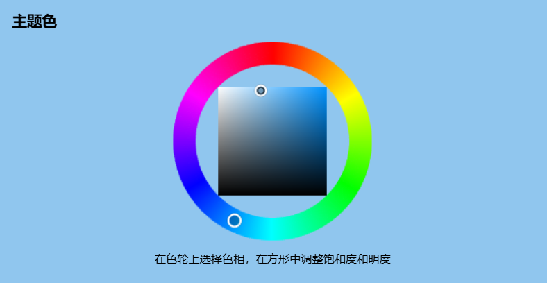
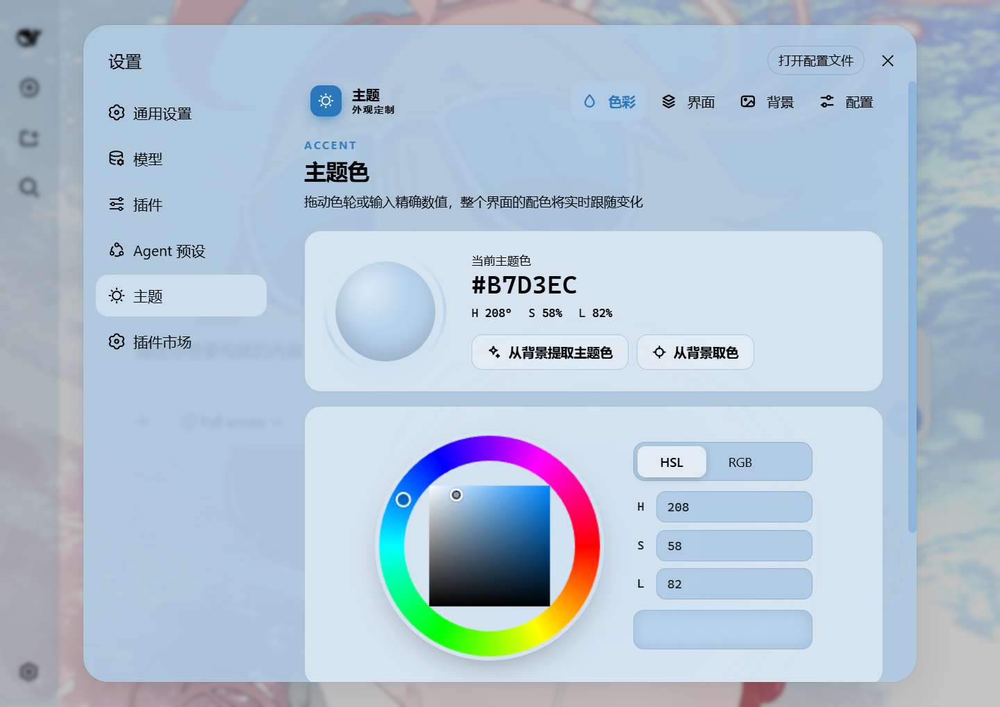
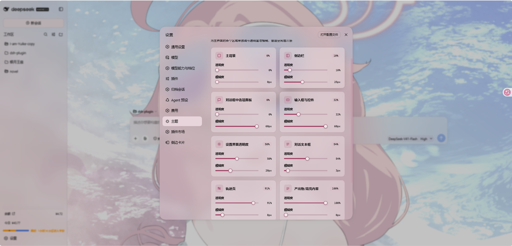
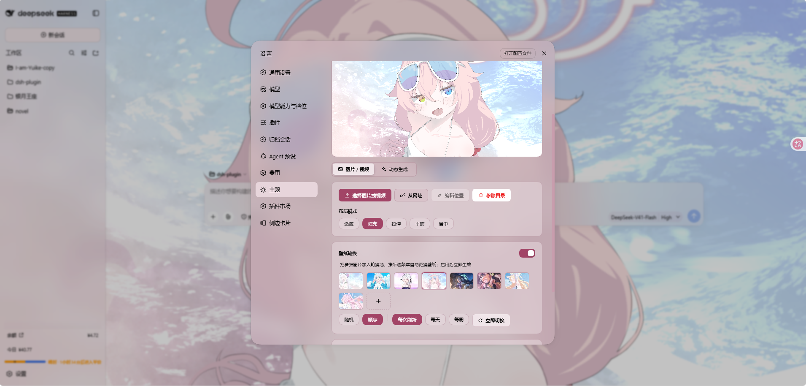
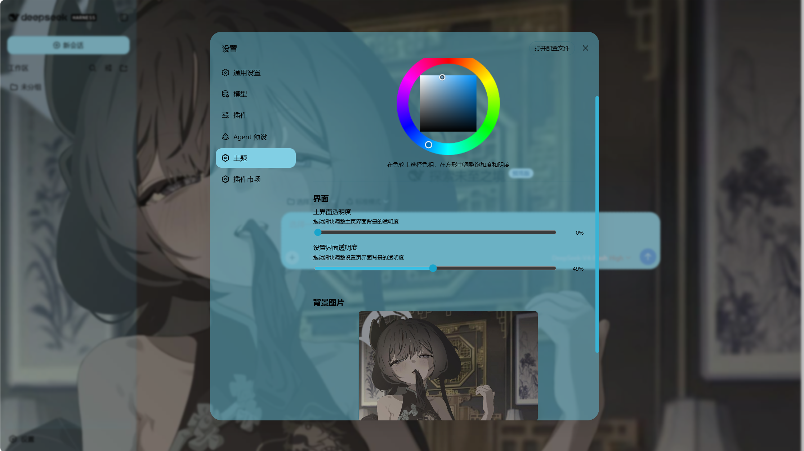
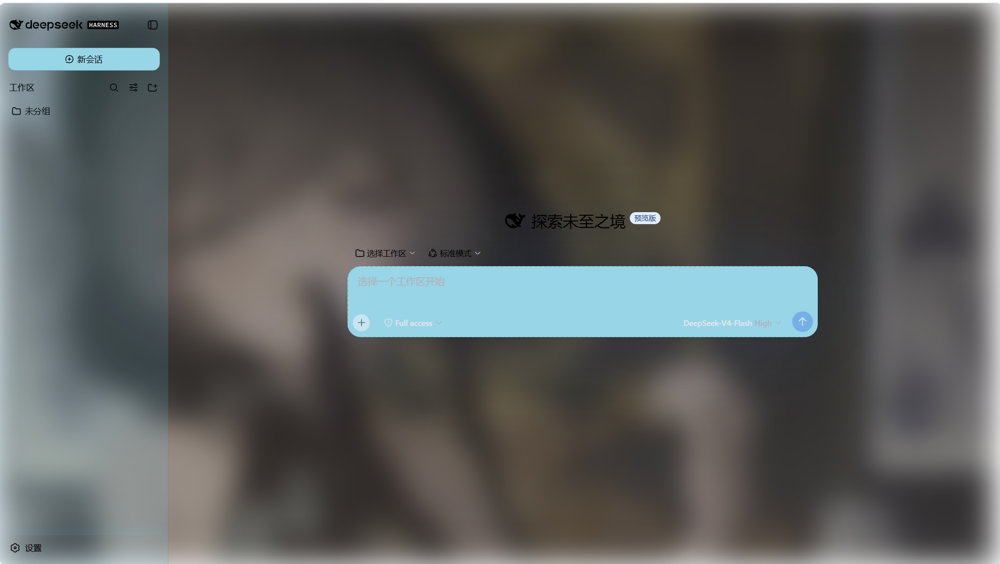
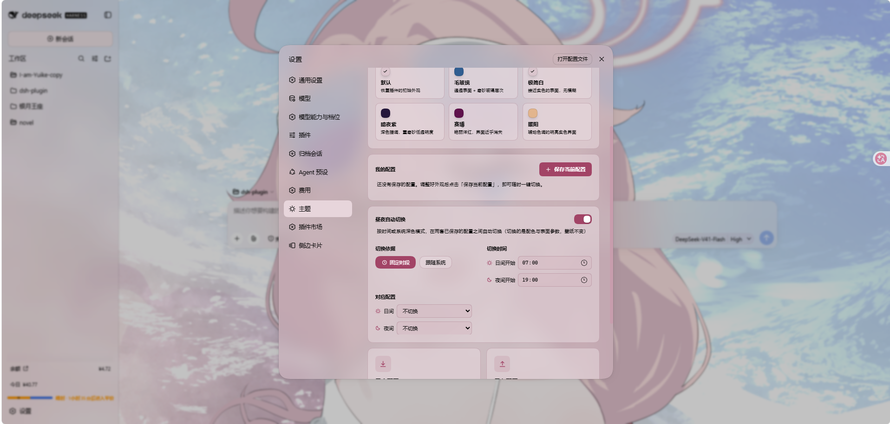

# dsh-any-background

<p align="center">
  <a href="https://www.npmjs.com/package/dsh-any-background"></a>
  <a href="https://www.npmjs.com/package/dsh-any-background"></a>
  <a href="https://github.com/Tkingxiao/dsh-any-background/blob/main/LICENSE"></a>
  <a href="https://www.npmjs.com/package/@deepseek-ai/dsh?activeTab=versions"></a>
  <a href="https://github.com/topics/dsh-better-sidebar"></a><br /><br />
  <a href="https://github.com/Tkingxiao/dsh-any-background"></a>
  <a href="https://dsh.directory/plugins/tkingxiao/dsh-any-background"></a>
</p>

[English](README.md) | 中文

一个 **DeepSeek Harness** 外观插件：自定义主题色、背景壁纸（图片 / 视频 / 算法生成），以及逐表面的透明度与模糊度控制。兼容 **DSH `0.2.0-rc.1` 直至 `0.2.2-rc.3`，其上所有版本一并放行**。

---

## 截图

<table>
  <tr>
    <td align="center"><br/><em>自定义主页 · 壁纸与主题色同时生效</em></td>
    <td align="center"><br/><em>主题色选择器 · PS 风格色轮 + HSL/RGB 输入</em></td>
  </tr>
  <tr>
    <td align="center"><br/><em>分部位透明度与模糊度</em></td>
    <td align="center"><br/><em>背景编辑器 · 平移与缩放</em></td>
  </tr>
  <tr>
    <td align="center"><br/><em>动态生成背景 · 网格渐变 / Shader / 几何</em></td>
    <td align="center"><br/><em>动态生成背景 · 几何低多边形</em></td>
  </tr>
  <tr>
    <td align="center" colspan="2"><br/><em>配置的导出与导入，方便分享</em></td>
  </tr>
</table>

## 功能特性

### 色彩与主题

- **PS 风格色轮** — 色环取色相、内嵌方形调饱和度与明度，实时生成 30+ 个 CSS 设计令牌。
- **精确 HSL / RGB 输入** — 数值输入，与色轮双向同步。
- **智能取色 / 吸管取色** — 一键从壁纸提取主题色（采样可见区域、剔除灰色与近黑近白），或在壁纸上悬停取任意一点；视频壁纸自动截帧参与。全程在客户端完成。
- **强制界面明暗** — 亮 / 暗 / 自动。「自动」下表面与字体方向由主题色明度决定（深色 → 浅字，浅色 → 深字），未选主题色时按壁纸亮度判断。
- **主题导出 / 导入** — 一键导出自包含的 `dsh-any-theme.json`（配置 + 壁纸 + 整个轮换池），随时导入还原。
- **外观预设与档案** — 六套一键预设，外加可重命名、可复制的自定义档案；删除有二次确认。

### 背景与壁纸

- **图片壁纸** — 上传任意图片作为背景。
- **视频壁纸** — 静音循环播放，刷新不丢失（落盘持久化 + HTTP Range 流式播放），并自动截取一帧用于预览、取色与位置编辑。
- **位置编辑器与布局模式** — 拖动平移、滚轮或双指缩放、一键重置；适应 / 填充 / 拉伸 / 平铺 / 居中，图片与视频的位置各存各的，互不覆盖。
- **动态生成背景** — 网格渐变 / Shader / 几何图案，可调扩散范围与色彩强度、锁定种子。
- **壁纸轮换** — 缩略图选择器组池，按随机或顺序、每次刷新 / 每小时 / 每天 / 每周更换；页面开着也会按时推进。
- **昼夜自动切换** — 指定日间与夜间两套配置，按固定时段或跟随系统深色模式自动切换。

### 逐表面的透明度与模糊

- **十一个部件各自一对滑块** — 主背景、侧边栏、卡片面板、输入框与控件、设置面板、对话文本框、轨迹页、右方侧边栏（或 bettersidebar）、产出物 / 高亮内容、顶栏浮层、标题栏。
- **滑块就是磨砂量，0 就是没有磨砂** — 会盖掉宿主默认的菜单磨砂；每个部件的**默认值仍是 30px**，所以全新安装保持宿主的磨砂观感。
- **透明度改的是宿主令牌本身** — 不在原色上再叠一层新色，壁纸从内容后方透出来。
- **产出物 / 高亮内容共用一支滑块** — 代码块（含语言顶栏）、行内 `code` 芯片与产出物 chip 同步。
- **右方侧边栏 / bettersidebar 同一对滑块两种身份** — 未装 dsh-better-sidebar 时驱动官方右侧栏，装了之后接管它的底部工作台面板（官方侧栏同样生效）。
- **桌面壳（Windows）还管标题条带** — 「侧栏」那对滑块同时驱动侧栏正上方的条带分段，切口随侧栏宽度拖动与折叠跟进（宽度 0 时整条交还「标题栏」）；「标题栏」卡片驱动其余分段与原生按钮区，并提供「标题条带文字」四态（自动 / 跟随主题 / 始终白 / 始终黑）供条带发浅时裁定文字颜色。

### 界面部件

- **侧边栏「主题」页面（双模式）** — 同一套五页（色彩 / 界面 / 字体 / 背景 / 配置）注册到官方右侧栏引导页或 dsh-better-sidebar 的侧栏，与设置面板三处共用一份状态，改一处处处同步；宿主没有该扩展点时静默不注册。
- **对话视图卡片** — 消息列表自动包成半透明卡片，轨迹页可整页调节。
- **顶栏浮层与标题栏各自可调** — Agent Team 面板、后台任务列表、会话头部下拉菜单，以及会话顶部那条标题 / 页签行，都有独立的透明度 + 模糊。
- **自定义字体** — 上传 ttf / otf / woff / woff2（上限 100 MB）应用到整个界面，代码块保持等宽；可随时停用或移除。
- **分组文字描边** — 与界面页同一套分组，每组独立 `-webkit-text-stroke`（0–4px，0 = 关闭），颜色可自动反色 / 灰 / 黑 / 白 / 主题色 / 自定义；代码块、`inline code`、图标与宿主的流光文字自动豁免。
- **第三方插件兼容** — 认出 [dsh-better-display](https://github.com/aa2246740/dsh-better-display) 时把它那条吸顶总结栏钉在 20% 底板 + 30px 磨砂、不随滑块；其它插件的表面若吃了本插件接管的令牌会在控制台点名，设置页可以整体关掉。

### 其它

- **文件持久化** — 所有设置落盘在 `~/.dsh/.dsh-any-background-data/`，不依赖 `localStorage`。
- **中英双语界面** — 自动跟随宿主语言设置。
- **主题守护** — 宿主重置主题后自动重新激活自定义主题。

## 更新日志（只保留最近两个版本）

### v0.4.3（跟到 dsh `0.2.1-rc.5` 与新开的 `0.2.2` 线）

- **新增核对的宿主构建**：`0.2.1-rc.4`、`0.2.1-rc.5`、`0.2.2-alpha.2`。
- **`rc.4` / `rc.5` 不改动任何东西。** 把 rc.3 装机目录里 296 个 `@deepseek-ai/dsh-*` 包、5604 个产物文件逐个取哈希：跨到 rc.5 只有 30 个文件变过，且没有一个是本插件读的那张样式表——三处只是内联的版本号字符串，其余是宿主设置页标签的提示条改成按需弹出、以及思考过程正文插槽多传一个 `rawText`。令牌、`[class*="…"]` 类形状、`z-index`、`data-slot` 一个都没动，于是两个构建并入 `v0-2-1` 的档位，判定从 `line` 升为 `exact`。
- **`0.2.2` 是一条新补丁线，另开 `v0-2-2` 事实目录。** 这一版动静大（1151 个文件改动、1709 个新增），但本插件声称的每一项事实逐条重读后仍然成立：`_handle{z-index:11}` / `_leadingSeat{z-index:15}` / `_overlayLayer{z-index:20}` 逐字节一致（所以侧栏列 `z-index:1` 的上限和标题行 `z-10` 的论证照旧），菜单霜的四个令牌与 8 个 `--dsw-menu-backdrop-filter` 消费者不变，宿主仍在 `body` 上合成 `--dsw-font-family`（字体规则的 `!important` 仍须胜出），5 个会话头部插槽键不变；本插件写到的 75 个宿主选择器全部还能命中。宿主侧的 peer 门禁实现逐字节未变。
- **`0.2.2` 上两处值得记下的宿主改动**：`--dsw-specific-sidebar-nav-item-hover` 被宿主删掉了（连它唯一的消费者一起），本插件仍会写这个令牌——写了没人读，且宿主自己本来也不再画那个悬停底色，相对宿主默认观感没有退步；`ui-plugin-manager` 新增一处用「主界面」接管的那个令牌做底板（页面头部一条 `pointer-events:none` 的垫层），默认值下什么都不画，但这是「谁在读这个令牌」清单上新增的一行。
- **兼容门禁新增一致性自检**：`npm test` 现在会核对 `engines.dsh`、六条 peer、`dsh.compatibility.dsh` 四处是否点名了每一个已核对构建、是否都留着不设上界的尾巴，并核对 `lib/` 里确实带着这些构建与对应的渠道（改了 `src/` 忘了重新 bundle 会被直接抓住）。
- 装完或更新后请**重启一次宿主**——兼容门禁在组装 profile 时才跑。

### v0.4.5（issue #35 / #36 / #38 · 核对 `0.2.2-rc.2` / `0.2.2-rc.3`）

- **issue #36 —— 标题栏下方随视频闪烁的暗带消失。** 视频壁纸 + 标题栏半透明（模糊度 0）+ 对话文本框 100% 不透明时，Firefox（窗口化 GPU 合成）会在会话标题栏底边画一条随视频帧闪烁的 ~18px 暗带。根因：对话卡片的磨砂垫层（`backdrop-filter`）挂在一张完全不透明的卡片背后，视觉上是空操作——但滤镜表面仍迫使合成器在视频的每一帧重建，采样间歇性地把标题栏的深色内容采进去。`applyViewCards` 现在在卡片透明度滑块为 100% 时完全跳过垫层（报告者已逐像素验证无差异）；半透明卡片照旧保留磨砂，轨迹页不受影响。
- **issue #38 —— `dsh-session-manager` 已登记并钉住。** 它的整套弹窗（`.sm-panelDialog` 及同族，承载头部菜单 / 自定义下拉的覆盖层）通过 `--dsw-alias-bg-layer-1` 的 `color-mix` 派生表面，输入框与菜单直读 layer-2/3——「对话框选项面板」滑块把它淡化成半透明，而它自己没有任何磨砂，文字与壁纸、底部面板的内容叠在一起。新钉值在其根元素上把三个 layer 令牌重发为**不透明**字面量（沿用 dshmarket 浮层的先例：只发令牌字面量、不发磨砂，它自己的「弹窗不透明度」混色照常工作）。设置卡片现在把它列为已钉住，开机日志会点名。
- **issue #35 ① —— 轮换池缩略图点击即应用。** 以前轮换池只能"推进"（随机 / 顺序 / 立即切换），永远落不到指定的某一张上。现在点击缩略图（悬停出现「应用这张」角标）即激活该图片，走与轮换推进完全相同的路径（含主题色重新提取），并且与宿主激活路径一致地**不重置**轮换时钟（`lastRotate`）。支持键盘操作，当前项点击无效。
- **issue #35 ② —— 网址壁纸支持每日自动刷新。** 从网址应用壁纸后，背景页会出现「每日自动刷新」开关。到天边界（下一次 30 秒 tick，或下次启动）时，宿主会重新下载该网址并应用——适合会随时间返回新图片的地址（必应每日一图类接口）。静态网址只是重新应用同样的字节。每天只尝试一次（失败也记时间戳，坏地址不会被每 30 秒锤一次）；轮换池启用时暂停，避免两边抢同一张壁纸；移除壁纸时一并清除。下载走既有的宿主侧通道，字节不过 RPC。
- **核对 `0.2.2-rc.2` 与 `0.2.2-rc.3`**（读两个 tag 的源码树）。同一条补丁线、同一份适配层答案，判定 `exact`。唯一的行为差异：`design-platform.css` 新增 darwin 专属的 `--dsw-specific-sidebar-wash-top/-bottom`（连同 `-tint`、`-glass-*`）绘制 macOS 侧栏列——tint 从 fill 令牌派生、本来就跟滑块走；两个静态 wash 并入「侧边栏」透明度组（独立插件变量；`toRgba` 同时支持了它们使用的现代 `rgb(r g b / a)` 语法），且在非 darwin 宿主上完全不生效。`conversation.hero.frame` / `[data-phase='hero']` 阶段不挂 `[data-chat-flow]`，`applyViewCards` 本就视作"视图未挂载"。门禁四处枚举与 `dshReleases` 已点名两个构建；master 上尚未发版的改动（DocumentStyles `data-plugin`/`data-path` 管线、ThemePresenter 的 style 观察器）已记进适配层，留给下一个版本。

### v0.4.4（真机核对 `0.2.2-rc.1` · issue #34 第三方登记与反馈 · issue #33 数值输入与区域高亮）

- **真机核对 `0.2.2-rc.1`。** 在 launcher `homes/0.2.2-rc.1` 建隔离测试档（本地插件用 link，另装 dshmarket `1.73.16` / dsh-better-sidebar `0.30.1` / dsh-update-checker `1.7.3`）启动 `dsh web`：兼容门禁放行，`read` 回 `host.version=0.2.2-rc.1 / channel=0.2.2`，配置写入与重读落盘一致；独立 headless Chrome 开机抓到 179 张 `style[data-plugin]`，三条「未登记」日志与 issue #34 逐字吻合。于是该构建进入四处门禁与 `dshReleases`，判定从 `line` 升为 `exact`。
- **适配层事实复核：三处证据字面量变了，但没有一处是规则输入。** 逐个读该 tag 的 98 个 `lib/client.js`：`_handle{z-index:11}` / `_leadingSeat{z-index:15}` / `_overlayLayer{z-index:20}`、菜单令牌名、9 个 `--dsw-menu-backdrop-filter` 消费者、`data-shimmer` / `data-shell-bottom` / `data-rightbar-col`、会话头部插槽键全都还在。变的是 `--dsw-menu-surface-fill`（`#f8f9fa94` / `#43454a73` → `#fcfdfeb3` / `#303136a3`）、`--dsw-font-family`（收成单条 `var(--dsh-font-family-text-default)`，仍是 `body` 声明，字体规则的 `!important` 照旧胜出）、以及 `--dsh-dockkit-float-top` 不再发出（本档不发 promotion，不受影响）。适配层只读令牌名，答案不变；细节记进 `v0-2-2/adapter.ts`。像素级模糊/遮挡 A/B 仍未跑。
- **issue #34：三家从「未登记」变成有结论。** 补两条低风险钉值——dshmarket 的「任务」浮层（`--dsw-alias-bg-layer-1`）与 dsh-update-checker 的两个按钮（`--dsw-alias-bg-layer-2`）——只重发令牌字面量，不动 `background` / 几何 / 磨砂；四个选择器名在该宿主产物里 0 命中。`dsh-better-sidebar` 登记为**已核对、故意不钉**：它的整块面板正是「主界面」滑块要调的东西，替用户钉死等于把滑块拿走。钉值仍集中在一张 `-third-party` 动态表里，开关一撤到底。
- **反馈不再依赖控制台。** 设置卡片逐行列出包名、状态与令牌，并有「复制诊断行」按钮（带宿主版本与开关状态）；生产构建开不了 DevTools 也能一键复制，剪贴板不可用时给可手动选中的文本框。
- **issue #33 的第 1、2 项。** ① **滑块数值可输入**：每个滑块旁多了数字框，拖动时双向同步，越界收敛、空值不提交；仍走原来的零延迟 DOM 路径，不引入重渲染。② **悬停高亮对应区域**：悬停任一模块卡片，会在真实界面上框出它管的区域。三列直接复用 `setBlur` / `applyPartOpacities` 涂色的**同一批节点**，其余区域只用插件自己规则里的 `data-*` 标记与运行时标签，不写宿主节点、不碰第三方 z-index——只画一个 `fixed` + `pointer-events:none` 的描边层，鼠标离开或离开设置页即整层移除；位置靠捕获阶段的 `scroll` / `resize` 事件更新，不挂 rAF。**配色复用插件自己的明暗判定器 `rScheme()`**（强制方向 > 主题色明度 > 壁纸亮度判定），取它的**反色**：暗界面铺白色半透明板、亮界面铺黑色半透明板，标签同样反色，全程纯中性黑白。既不碰从壁纸提取的 `--dsw-alias-brand-primary`（换主题色就会撞背景），也不引入固定强调色（遇到同色壁纸照样撞）。色块以 2.4s `ease-in-out` **持续缓慢呼吸**（填充 opacity 22% ↔ 100%，不是入场闪一下），动画只作用于填充伪元素，虚线和标签保持静止；`prefers-reduced-motion` 下退化为静态色块，嵌套目标只画最外层以免透明度叠加。实测暗底白板 / 亮底黑板的亮度差 `0.243 / 0.240`，反过来选错方向只有 `0.015 / 0`；琥珀色壁纸上白 / 黑板分别 `0.067 / 0.178`，都不撞色。当前页面没有该区域时明确提示，而不是画一个猜测的框，这也正是 issue 里「某些界面没有对话不会出现」的诚实答案。其余三项（逐模块注释、会话结束 token 用量模块、模型选择器子菜单）需要逐界面的结构探测，本版未做。
- 装完或更新后请**重启一次宿主**——兼容门禁在组装 profile 时才跑。

## 安装

### 方式一：npm 安装（推荐）

```sh
# 已发布到 npm registry
dsh plugin --profile web add dsh-any-background

# 或直接安装 GitHub 仓库
dsh plugin --profile web add github:Tkingxiao/dsh-any-background
```

然后启动：

```sh
dsh web
```

插件会出现在设置面板的 **“主题”** 分类中。

### 方式二：npx（无需全局安装）

```sh
npx @deepseek-ai/dsh plugin --profile web add dsh-any-background
npx @deepseek-ai/dsh web
```

### 方式三：本地构建（开发）

`lib/` 目录已提交，安装后无需构建。修改 `src/` 后重新构建：

```sh
git clone https://github.com/Tkingxiao/dsh-any-background.git
cd dsh-any-background
pnpm install
pnpm run bundle
pnpm dsh plugin --profile web add "dsh-any-background"
pnpm dsh web
```

## 兼容性

- **[`dsh web`](https://github.com/deepseek-ai/deepseek-harness)：`0.2.0-rc.1` ~ `0.2.2-rc.3`，其上所有版本一并放行。** 门禁先逐一列出核对过的构建，再以不设上界的 `>=0.2.0-rc.1` 收尾。这是有意的：宿主强制的正是这份 peer 列表，范围没写到的版本会在导入任何模块之前被整行禁用——一条写到头的范围等于在一款还能工作的插件前面砌墙。（更准确地说：宿主 `app-boot` 的 `unmetRequirements` 在 `engines.dsh` 存在时只看它自己、忽略 peer，所以四处都要写、但真正决定加载的是 `engines.dsh`。）
- **没见过的构建怎么跑**：取最近的一份事实，并在日志里写清它离 `exact` 有多远。一份过期事实最坏的代价是某个滑块不再淡出宿主已经搬走的那个表面，而一道失败关闭的版本检查代价是整个插件。
- **核对过的构建**（`dsh.compatibility.dshReleases`）：

  | 宿主构建 | 事实目录 | 说明 |
  |---|---|---|
  | `0.2.0-rc.1` | `v0-2-0-rc-1` | 按 tag 逐包 diff 核实 |
  | `0.2.0-rc.2` | `v0-2-0-rc-2` | 同上；这一版改了吸顶菜单分组标题取色的令牌，所以另开一份事实 |
  | `0.2.1-alpha.1` ~ `0.2.1-rc.5` | `v0-2-1` | 事实未变，并入同一份；每个核对过的构建各占一行，判定为 `exact`。`rc.4` / `rc.5` 的产物与 `rc.3` 逐个文件哈希一致 |
  | `0.2.2-alpha.2` | `v0-2-2` | 新开的补丁线，另开一份事实；逐条重读后答案与 `v0-2-1` 相同（层级阶梯、菜单霜令牌、字体令牌、头部插槽键、75 个宿主选择器命中） |
  | `0.2.2-rc.1` | `v0-2-2` | **真机核对**：门禁 / RPC / 开机自检全过；98 个产物文件里规则输入全部仍命中，三处证据字面量变动已记进适配层注释；判定 `exact` |
  | `0.2.2-rc.2` / `0.2.2-rc.3` | `v0-2-2` | 从两个 tag 的源码逐条重读：同一条补丁线、同一份答案；唯一的行为差异——darwin 专属的侧栏 wash 令牌——已并入「侧边栏」滑块组，其它平台不生效；判定 `exact` |
  | `0.2.2-rc.3` 之上 | 沿用该行最近的核对结果 | 未核对的新构建取档位并写日志 |

- **版本事实按 release 隔离**：宿主版本由 Node 半侧解析、随 `read` RPC 下发，样式与逻辑只向适配层提问（这块表面归谁、磨砂挂在哪一层、菜单该重写哪些令牌），不比较版本字符串；适配新宿主 = 新增一个版本目录并在注册表登记。
- **安装或更新插件后仍需重启宿主**：兼容检查发生在组装 profile 时，而不是插件更新时。依赖特定宿主结构的功能（右侧栏面板模糊、官方侧栏「主题」卡片）只在对应宿主上启用，其余功能在整个范围内表现一致。
- **`0.1.5` / `0.1.6` / `0.1.7` 已移出兼容范围**：那些事实目录断言的东西再没有核对过，而一张没人核对的表比没有表更糟；更旧的宿主会在组装期被明确拒绝，而不是被一份错的适配事实悄悄改版式。
- **[DSHA](https://github.com/DSH-APP/DSHA)** — DeepSeek Harness 安卓启动器（免 ROOT、免 Termux）。包内 dsh 为 `0.1.5-rc.2`，低于本插件的兼容下界：peer 门禁会在组装期拒绝它，插件在那上面根本不加载。
- **[deepseek-harness-desktop](https://github.com/anywhere-labs/deepseek-harness-desktop)** — 支持。Windows 专属行为（标题条带、原生按钮区）只在桌面壳上生效。

## 权限、副作用与边界

- **接入形态**：官方 Profile Bundle——`package.json` 声明 `dsh.bundle.patch: ./cordis.patch.yml`（loader 插入层），仓库直接提交可用的预构建产物（`lib/index.js`、`lib/client.js`）。无安装脚本、无 postinstall、无 native 二进制，安装时不执行任何构建。
- **文件系统**：服务端只在 `<dsh 主目录>/.dsh-any-background-data/` 内读写（配置、壁纸、轮换池、视频、字体），不触碰该目录之外的任何路径；配置写入为原子写（临时文件 + rename）。这些文件落在真实磁盘上，**不受 generation 恢复影响、也不会被其回滚**——删除该目录即彻底重置插件。
- **网络**：只有当用户自己粘贴 http/https 图片或视频网址并点击「应用」时才发起一次出站下载；无遥测、无其它外部调用。
- **Shell / native**：无。不用 `child_process`、不加载 native 模块、不运行动态下载的二进制。
- **HTTP 面**：只在本机 dsh web 服务下注册 `/dsh-any-background/{video,wallpaper,font}`（GET/HEAD 流式）与对应 `*/upload`（POST，上限 100 MB），以及专用 RPC 通道 `/dsh-any-background`；不新增对外监听端口。
- **是否需要重启**：首次安装后需（重新）启动 `dsh web` 加载客户端 bundle；此后设置变更实时生效、自动落盘。更换插件版本需重启以加载新的 `lib/client.js`。
- **测试与验证**：`pnpm run typecheck`（tsc 全量类型检查）、`pnpm run bundle`（tsdown 产出 `lib/`）、`npm test`（起真实宿主半侧，跑「写盘 → 重读 → 档案」往返与上传围栏断言）。视觉类改动另有两条路径：本地 mock 页量 computed 值，以及在真实 `dsh web` 上逐个滑块实测。
- **已知限制**：
  - 样式依赖宿主 DOM 的稳定标记（如 `[data-sidebar-right-panel]`）与 CSS 令牌名；宿主大版本重构样式层时选择器可能失效，表现为相关滑块不再作用于对应表面（只影响观感，不影响稳定性）。版本相关的那部分选择器集中在对应的版本目录里，宿主改版通常只需改那一份。
  - `-webkit-text-stroke` 在部分单行省略号容器边缘约有 1px 裁切。
  - 有一条规则是对其它插件的有意让步：dsh-better-display 的吸顶车道用的正是「主界面」透明度接管的那个令牌，所以认出该插件后会把它钉在 20% 底板 + 30px 磨砂上、不随滑块；对方若改名，这条规则就匹配不到，车道回到它自己的画法。

## Star History

[](https://www.star-history.com/?repos=Tkingxiao%2Fdsh-any-background&type=timeline&legend=bottom-right)

## 许可

MIT
