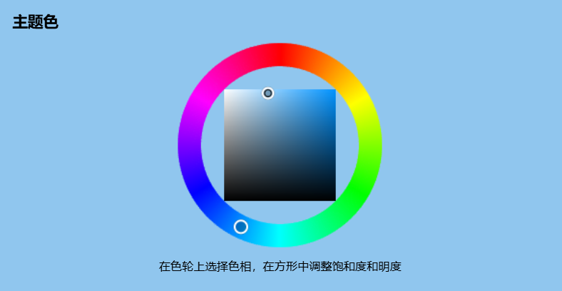
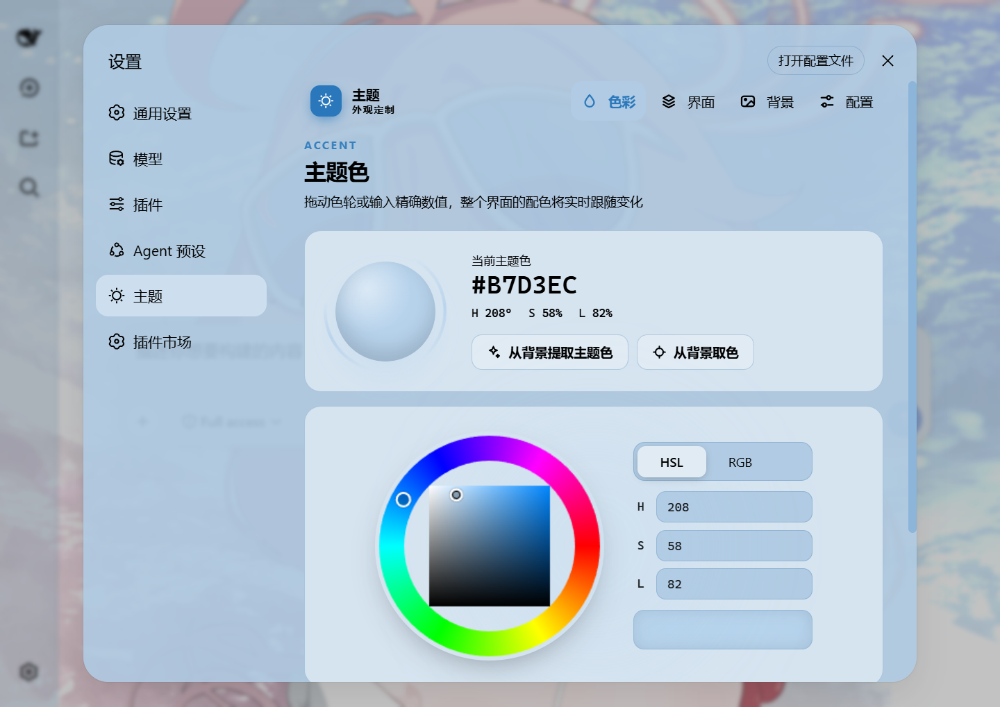
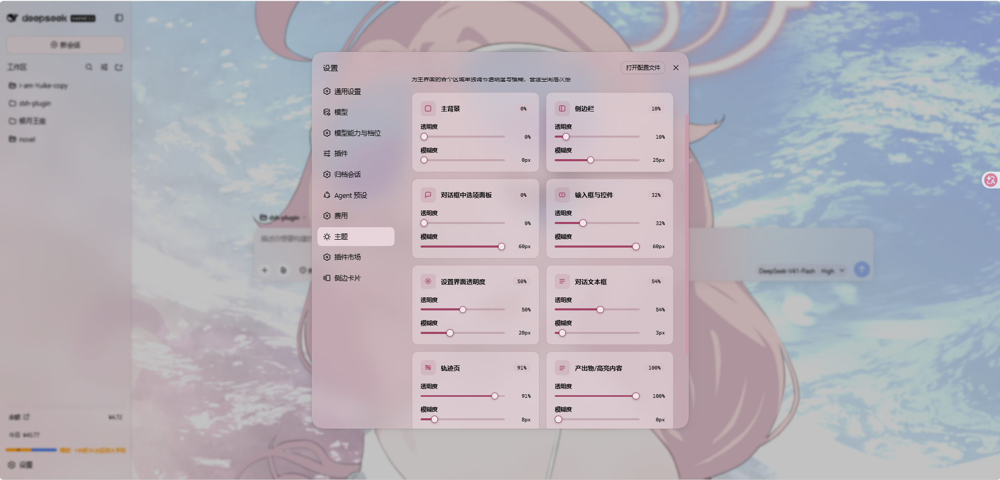
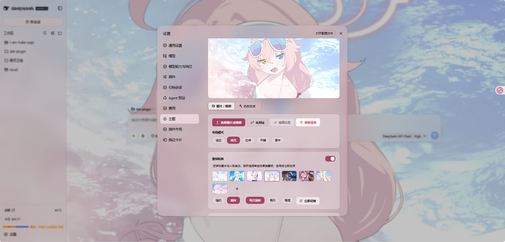
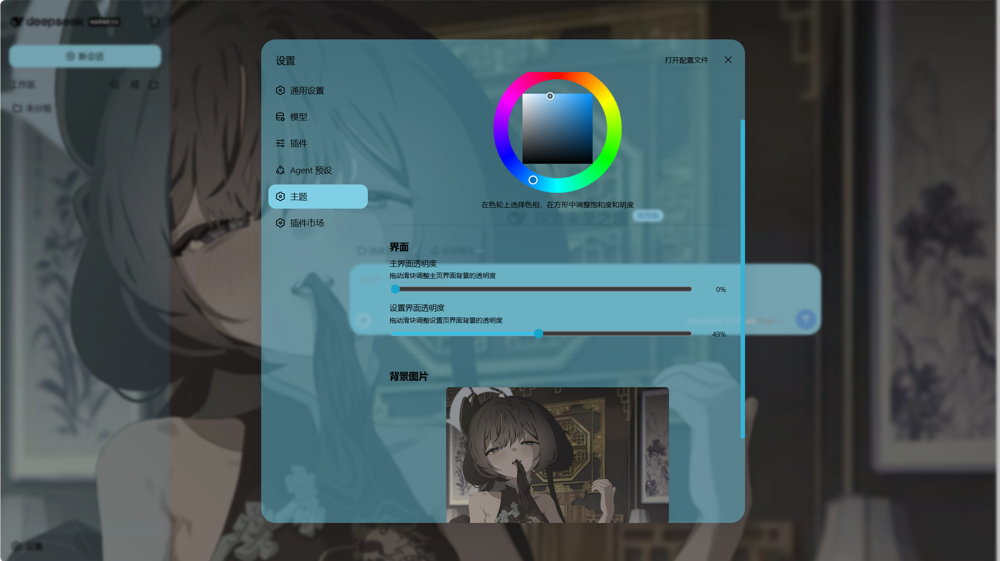
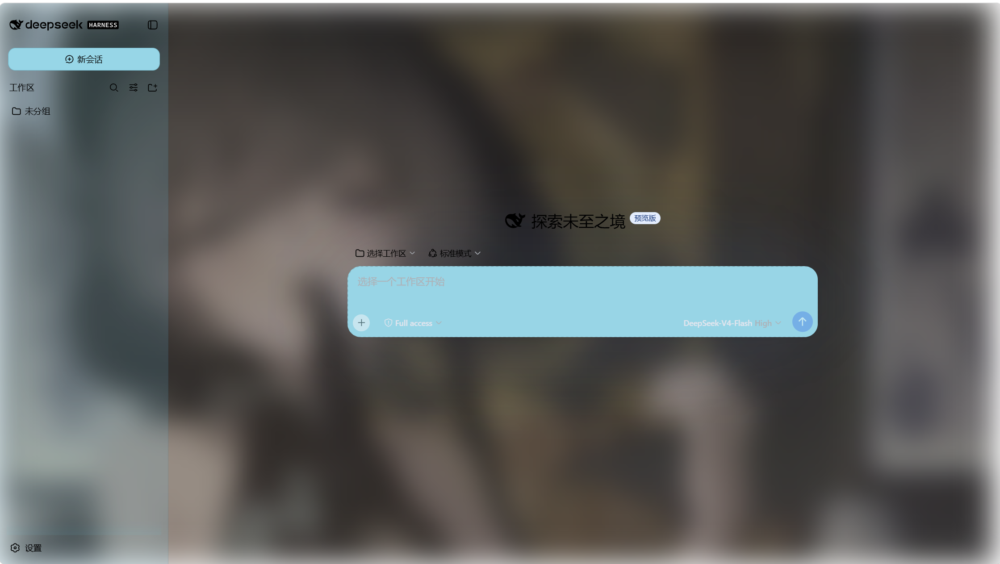
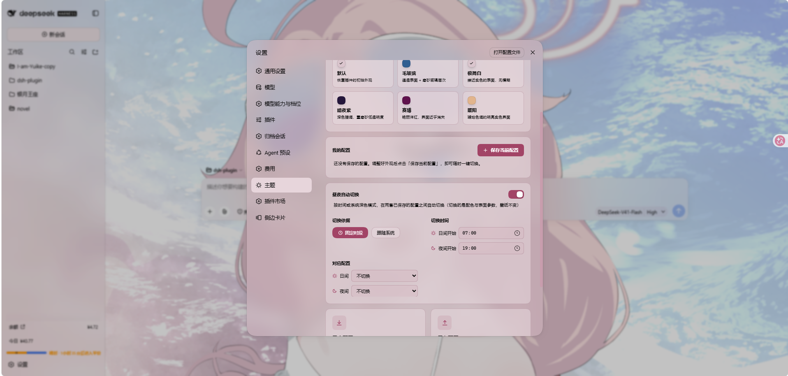

# dsh-any-background

<p align="center">
  <a href="https://www.npmjs.com/package/dsh-any-background"></a>
  <a href="https://www.npmjs.com/package/dsh-any-background"></a>
  <a href="https://github.com/Tkingxiao/dsh-any-background/blob/main/LICENSE"></a>
  <a href="https://www.npmjs.com/package/@deepseek-ai/dsh?activeTab=versions"></a>
  <a href="https://github.com/topics/dsh-better-sidebar"></a><br /><br />
  <a href="https://github.com/Tkingxiao/dsh-any-background"></a>
</p>

[English](README.md) | 中文

一个 **DeepSeek Harness** 外观插件：自定义主题色、背景壁纸（图片 / 视频 / 算法生成），以及逐表面的透明度与模糊度控制。兼容 **DSH `0.2.1` 直至 `0.2.2-rc.3`，其上所有版本一并放行**。

---

## 截图

<table>
  <tr>
    <td align="center"><br/><em>自定义主页 · 壁纸与主题色同时生效</em></td>
    <td align="center"><br/><em>主题色选择器 · PS 风格色轮 + HSL/RGB 输入</em></td>
  </tr>
  <tr>
    <td align="center"><br/><em>分部位透明度与模糊度</em></td>
    <td align="center"><br/><em>背景编辑器 · 平移与缩放</em></td>
  </tr>
  <tr>
    <td align="center"><br/><em>动态生成背景 · 网格渐变 / Shader / 几何</em></td>
    <td align="center"><br/><em>动态生成背景 · 几何低多边形</em></td>
  </tr>
  <tr>
    <td align="center" colspan="2"><br/><em>配置的导出与导入，方便分享</em></td>
  </tr>
</table>

## 功能特性

### 色彩与主题

- **PS 风格色轮** — 色环取色相、内嵌方形调饱和度与明度，实时生成 30+ 个 CSS 设计令牌。
- **精确 HSL / RGB 输入** — 数值输入，与色轮双向同步。
- **智能取色 / 吸管取色** — 一键从壁纸提取主题色（采样可见区域、剔除灰色与近黑近白），或在壁纸上悬停取任意一点；视频壁纸自动截帧参与。全程在客户端完成。
- **强制界面明暗** — 亮 / 暗 / 自动。「自动」下表面与字体方向由主题色明度决定（深色 → 浅字，浅色 → 深字），未选主题色时按壁纸亮度判断。
- **主题导出 / 导入** — 一键导出自包含的 `dsh-any-theme.json`（配置 + 壁纸 + 整个轮换池），随时导入还原。
- **外观预设与档案** — 六套一键预设，外加可重命名、可复制的自定义档案；删除有二次确认。

### 背景与壁纸

- **图片壁纸** — 上传任意图片作为背景。
- **视频壁纸** — 静音循环播放，刷新不丢失（落盘持久化 + HTTP Range 流式播放），并自动截取一帧用于预览、取色与位置编辑。
- **位置编辑器与布局模式** — 拖动平移、滚轮或双指缩放、一键重置；适应 / 填充 / 拉伸 / 平铺 / 居中，图片与视频的位置各存各的，互不覆盖。
- **动态生成背景** — 网格渐变 / Shader / 几何图案，可调扩散范围与色彩强度、锁定种子。
- **壁纸轮换** — 缩略图选择器组池，点击缩略图直接应用该图，按随机或顺序、每次刷新 / 每小时 / 每天 / 每周更换；页面开着也会按时推进。
- **网址壁纸每日自动刷新** — 从网址应用的壁纸可在天边界自动重新下载，适合会随时间返回新图片的地址。
- **昼夜自动切换** — 指定日间与夜间两套配置，按固定时段或跟随系统深色模式自动切换。

### 逐表面的透明度与模糊

- **十一个部件各自一对滑块** — 主背景、侧边栏、卡片面板、输入框与控件、设置面板、对话文本框、轨迹页、右方侧边栏（或 bettersidebar）、产出物 / 高亮内容、顶栏浮层、标题栏。滑块数值可直接输入，悬停模块卡片会在真实界面上框出它控制的区域。
- **滑块就是磨砂量，0 就是没有磨砂** — 会盖掉宿主默认的菜单磨砂；每个部件的**默认值仍是 30px**，所以全新安装保持宿主的磨砂观感。
- **透明度改的是宿主令牌本身** — 不在原色上再叠一层新色，壁纸从内容后方透出来。
- **产出物 / 高亮内容共用一支滑块** — 代码块（含语言顶栏）、行内 `code` 芯片与产出物 chip 同步。
- **右方侧边栏 / bettersidebar 同一对滑块两种身份** — 未装 dsh-better-sidebar 时驱动官方右侧栏，装了之后接管它的底部工作台面板（官方侧栏同样生效）。
- **桌面壳（Windows）还管标题条带** — 「侧栏」那对滑块同时驱动侧栏正上方的条带分段，切口随侧栏宽度拖动与折叠跟进（宽度 0 时整条交还「标题栏」）；「标题栏」卡片驱动其余分段与原生按钮区，并提供「标题条带文字」四态（自动 / 跟随主题 / 始终白 / 始终黑）供条带发浅时裁定文字颜色。

### 界面部件

- **侧边栏「主题」页面（双模式）** — 同一套五页（色彩 / 界面 / 字体 / 背景 / 配置）注册到官方右侧栏引导页或 dsh-better-sidebar 的侧栏，与设置面板三处共用一份状态，改一处处处同步；宿主没有该扩展点时静默不注册。
- **对话视图卡片** — 消息列表自动包成半透明卡片，轨迹页可整页调节。
- **顶栏浮层与标题栏各自可调** — Agent Team 面板、后台任务列表、会话头部下拉菜单，以及会话顶部那条标题 / 页签行，都有独立的透明度 + 模糊。
- **自定义字体** — 上传 ttf / otf / woff / woff2（上限 100 MB）应用到整个界面，代码块保持等宽；可随时停用或移除。
- **分组文字描边** — 与界面页同一套分组，每组独立 `-webkit-text-stroke`（0–4px，0 = 关闭），颜色可自动反色 / 灰 / 黑 / 白 / 主题色 / 自定义；代码块、`inline code`、图标与宿主的流光文字自动豁免。
- **第三方插件兼容** — 认出 [dsh-better-display](https://github.com/aa2246740/dsh-better-display) 时把它那条吸顶总结栏钉在 20% 底板 + 30px 磨砂、不随滑块；其它插件逐个给出登记结论（设置卡片列出状态与令牌，一键复制诊断行），设置页可以整体关掉。

### 其它

- **文件持久化** — 所有设置落盘在 `~/.dsh/.dsh-any-background-data/`，不依赖 `localStorage`。
- **中英双语界面** — 自动跟随宿主语言设置。
- **主题守护** — 宿主重置主题后自动重新激活自定义主题。

## 安装

### 方式一：npm 安装（推荐）

```sh
# 已发布到 npm registry
dsh plugin --profile web add dsh-any-background

# 或直接安装 GitHub 仓库
dsh plugin --profile web add github:Tkingxiao/dsh-any-background
```

然后启动：

```sh
dsh web
```

插件会出现在设置面板的 **“主题”** 分类中。

### 方式二：npx（无需全局安装）

```sh
npx @deepseek-ai/dsh plugin --profile web add dsh-any-background
npx @deepseek-ai/dsh web
```

### 方式三：本地构建（开发）

`lib/` 目录已提交，安装后无需构建。修改 `src/` 后重新构建：

```sh
git clone https://github.com/Tkingxiao/dsh-any-background.git
cd dsh-any-background
pnpm install
pnpm run bundle
pnpm dsh plugin --profile web add "dsh-any-background"
pnpm dsh web
```

## 兼容性

- **[`dsh web`](https://github.com/deepseek-ai/deepseek-harness)：`0.2.1` ~ `0.2.2-rc.3`，其上所有版本一并放行。** 0.2.1 以下的老版本不再支持。门禁先逐一列出核对过的构建，再以不设上界的 `>=0.2.1-alpha.1` 收尾——宿主强制的正是这份列表（`engines.dsh` 存在时宿主只看它自己），范围没写到的版本会在导入任何模块之前被整行禁用。
- **核对过的构建**（`dsh.compatibility.dshReleases`）：

  | 宿主构建 | 事实目录 | 说明 |
  |---|---|---|
  | `0.2.1-alpha.1` ~ `0.2.1-rc.5` | `v0-2-1` | 事实未变，并入同一份；每个核对过的构建各占一行，判定为 `exact` |
  | `0.2.2-alpha.2` | `v0-2-2` | 新开的补丁线，另开一份事实；逐条重读后答案不变 |
  | `0.2.2-rc.1` | `v0-2-2` | **真机核对**：门禁 / RPC / 开机自检全过；判定 `exact` |
  | `0.2.2-rc.2` / `0.2.2-rc.3` | `v0-2-2` | 从两个 tag 的源码逐条重读：同一条补丁线、同一份答案；darwin 专属的侧栏 wash 令牌已并入「侧边栏」滑块组，其它平台不生效 |
  | `0.2.2-rc.3` 之上 | 沿用该行最近的核对结果 | 未核对的新构建取档位并写日志 |

- **版本事实按 release 隔离**：宿主版本由 Node 半侧解析、随 `read` RPC 下发，样式与逻辑只向适配层提问（这块表面归谁、磨砂挂在哪一层、菜单该重写哪些令牌），不比较版本字符串；适配新宿主 = 新增一个版本目录并在注册表登记。
- **安装或更新插件后仍需重启宿主**：兼容检查发生在组装 profile 时，而不是插件更新时。依赖特定宿主结构的功能（右侧栏面板模糊、官方侧栏「主题」卡片）只在对应宿主上启用，其余功能在整个范围内表现一致。
- **[deepseek-harness-desktop](https://github.com/anywhere-labs/deepseek-harness-desktop)** — 支持。Windows 专属行为（标题条带、原生按钮区）只在桌面壳上生效。

## 权限、副作用与边界

- **接入形态**：官方 Profile Bundle——`package.json` 声明 `dsh.bundle.patch: ./cordis.patch.yml`（loader 插入层），仓库直接提交可用的预构建产物（`lib/index.js`、`lib/client.js`）。无安装脚本、无 postinstall、无 native 二进制，安装时不执行任何构建。
- **文件系统**：服务端只在 `<dsh 主目录>/.dsh-any-background-data/` 内读写（配置、壁纸、轮换池、视频、字体），不触碰该目录之外的任何路径；配置写入为原子写（临时文件 + rename）。这些文件落在真实磁盘上，**不受 generation 恢复影响、也不会被其回滚**——删除该目录即彻底重置插件。
- **网络**：只有当用户自己粘贴 http/https 图片或视频网址并点击「应用」时才发起一次出站下载；无遥测、无其它外部调用。
- **Shell / native**：无。不用 `child_process`、不加载 native 模块、不运行动态下载的二进制。
- **HTTP 面**：只在本机 dsh web 服务下注册 `/dsh-any-background/{video,wallpaper,font}`（GET/HEAD 流式）与对应 `*/upload`（POST，上限 100 MB），以及专用 RPC 通道 `/dsh-any-background`；不新增对外监听端口。
- **是否需要重启**：首次安装后需（重新）启动 `dsh web` 加载客户端 bundle；此后设置变更实时生效、自动落盘。更换插件版本需重启以加载新的 `lib/client.js`。
- **测试与验证**：`pnpm run typecheck`（tsc 全量类型检查）、`pnpm run bundle`（tsdown 产出 `lib/`）、`npm test`（起真实宿主半侧，跑「写盘 → 重读 → 档案」往返与上传围栏断言）。视觉类改动另有两条路径：本地 mock 页量 computed 值，以及在真实 `dsh web` 上逐个滑块实测。
- **已知限制**：
  - 样式依赖宿主 DOM 的稳定标记（如 `[data-sidebar-right-panel]`）与 CSS 令牌名；宿主大版本重构样式层时选择器可能失效，表现为相关滑块不再作用于对应表面（只影响观感，不影响稳定性）。版本相关的那部分选择器集中在对应的版本目录里，宿主改版通常只需改那一份。
  - `-webkit-text-stroke` 在部分单行省略号容器边缘约有 1px 裁切。
  - 有一条规则是对其它插件的有意让步：dsh-better-display 的吸顶车道用的正是「主界面」透明度接管的那个令牌，所以认出该插件后会把它钉在 20% 底板 + 30px 磨砂上、不随滑块；对方若改名，这条规则就匹配不到，车道回到它自己的画法。

## 许可

MIT
